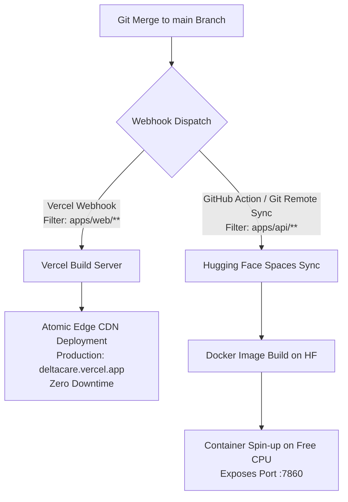

# Deployment Strategy & Platform Topography: DeltaCare

**Document Version**: 1.0.0  
**Phase**: Pre-Development Foundation Phase  
**Author**: Senior DevOps Engineer & Platform Architect  
**Status**: Authoritative DevOps Baseline  
**Approved References**: [ADR-002](../decisions/002-zero-dollar-hosting-strategy.md)

---

## 1. Zero-Cost Continuous Deployment Topography

DeltaCare's deployment strategy leverages Git-triggered continuous integration webhooks directly into **Vercel** and **Hugging Face Spaces**.

---

## 2. Platform Deployment Configuration

### 2.1 Frontend Deployment: Vercel Hobby Free Tier
- **Root Directory**: `apps/web`
- **Framework Preset**: Next.js
- **Build Command**: `npm run build`
- **Output Directory**: `.next` (or `out`)
- **Environment Variables**:
  - `NEXT_PUBLIC_API_URL`: Points to the production Hugging Face Spaces API URL (e.g., `https://<user>-deltacare-api.hf.space`).
  - `NEXT_PUBLIC_API_TIMEOUT_MS`: `20000`
  - `NEXT_PUBLIC_SLIDER_DEBOUNCE_MS`: `400`
- **Deployment Characteristics**: Atomic, zero-downtime, global edge distribution, free automatic SSL certificate.

### 2.2 Backend Deployment: Hugging Face Spaces (Docker SDK)
- **Space SDK**: Docker
- **Hardware Tier**: Free CPU Tier (2 vCPUs, 16GB RAM)
- **Container Port**: `7860`
- **Git Sync**: Code in `apps/api/` is synchronized to the Hugging Face Space Git repository.
- **Environment Variables**:
  - `ENVIRONMENT`: `production`
  - `PORT`: `7860`
  - `CORS_ORIGINS`: `https://deltacare.vercel.app`
  - `RATE_LIMIT_PER_MINUTE`: `60`
  - `MODEL_PATH`: `models/model.joblib`
  - `MINIMUM_PREMIUM_FLOOR`: `1000.00`

