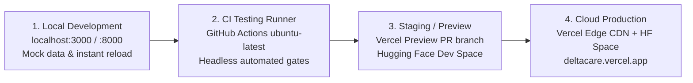

# Environment Management Strategy: DeltaCare

**Document Version**: 1.0.0  
**Phase**: Pre-Development Foundation Phase  
**Author**: Senior DevOps Engineer & Platform Architect  
**Status**: Authoritative DevOps Baseline  

---

## 1. Environment Topology & Matrix

DeltaCare establishes four segregated deployment environments:

---

## 2. Environment Configuration Matrix

| Configuration Variable | Local Development | CI Testing Runner | Staging / Preview | Cloud Production |
| :--- | :--- | :--- | :--- | :--- |
| **`ENVIRONMENT`** | `development` | `testing` | `staging` | `production` |
| **`PORT`** (API) | `8000` | `8000` | `7860` | `7860` |
| **`CORS_ORIGINS`** | `http://localhost:3000` | `http://localhost:3000` | `https://*-deltacare.vercel.app` | `https://deltacare.vercel.app` |
| **`RATE_LIMIT_PER_MINUTE`** | `120` (relaxed for dev) | `1000` (for load test) | `60` | `60` |
| **`MODEL_PATH`** | `models/model.joblib` | `models/model.joblib` | `models/model.joblib` | `models/model.joblib` |
| **`NEXT_PUBLIC_API_URL`** | `http://localhost:8000` | `http://localhost:8000` | `https://<dev-space>.hf.space` | `https://<prod-space>.hf.space` |
| **Swagger UI (`/docs`)** | **ENABLED** | **ENABLED** | **DISABLED** | **DISABLED** |
| **Debug Logging** | `DEBUG` | `INFO` | `INFO` | `INFO` (Zero PII) |

---

## 3. Environment Isolation Guarantees
- Local development configurations (`.env`, `.env.local`) are strictly git-ignored and never overwrite production settings.
- Staging pull request preview URLs on Vercel are ephemeral and isolated from production edge caches.

