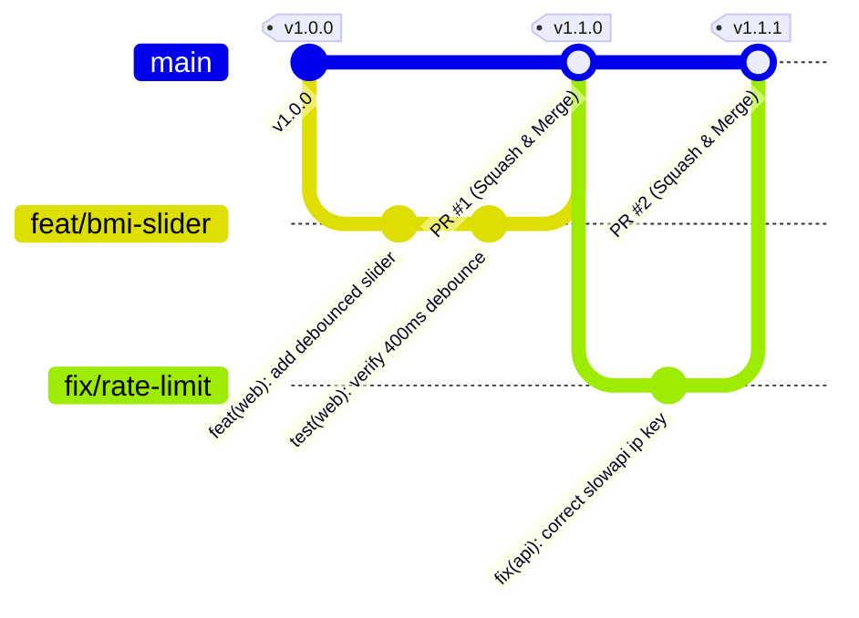

# Git Governance & Version Control Strategy: DeltaCare

**Document Version**: 1.0.0  
**Phase**: Pre-Development Foundation Phase  
**Author**: Senior DevOps Engineer & Platform Architect  
**Status**: Authoritative DevOps Baseline  

---

## 1. Branching Strategy: Trunk-Based Development with Short-Lived Feature Branches

DeltaCare enforces a streamlined **Trunk-Based Development** model. Long-lived feature branches, release branches, or stale develop branches are prohibited to minimize merge conflicts and ensure continuous integration.



---

## 2. Branch Hierarchy & Naming Conventions

| Branch Type | Target Prefix | Purpose / Scope | Base Branch | Merge Strategy |
| :--- | :--- | :--- | :---: | :---: |
| **Main / Production**| `main` | Production-ready, deployable codebase. Protected. | N/A | None (Direct commits blocked) |
| **New Features** | `feat/<short-title>` | Functional additions (e.g., `feat/what-if-badge`). | `main` | Squash and Merge |
| **Bug Fixes** | `fix/<short-title>` | Defect repairs and patches (e.g., `fix/cors-origin`). | `main` | Squash and Merge |
| **Documentation** | `docs/<short-title>` | Requirements, architecture, ADR updates. | `main` | Squash and Merge |
| **Refactoring** | `refactor/<short-title>`| Code structure improvements without behavior change. | `main` | Squash and Merge |
| **Chores / DevOps** | `chore/<short-title>` | Dependency upgrades, CI/CD workflow patches. | `main` | Squash and Merge |

---

## 3. Main Branch Protection Rules (GitHub)

The `main` branch is protected by strict GitHub repository rules:
1. **Require a Pull Request Before Merging**: Direct pushes to `main` are strictly blocked for all users (including repository administrators).
2. **Require Passing Status Checks**: All GitHub Actions workflows (`api-ci.yml`, `web-ci.yml`, `model-audit.yml`) must pass with green status before merging.
3. **Require Code Owner Review**: At least one approved review from a code owner listed in `.github/CODEOWNERS` is required.
4. **Require Linear History**: Merges must execute via **Squash and Merge** to maintain a clean, bisectable Git commit log.
5. **No Force Pushes**: `git push --force` is permanently disabled on `main`.
6. **No Branch Deletions**: Deleting `main` is permanently blocked.

---

## 4. Commit Message Conventions (Conventional Commits 1.0.0)

All commit messages must follow the Conventional Commits specification:

```text
<type>(<scope>): <short imperative summary>

[optional body explaining WHY the change was made]

[optional footer referencing requirements, issues, or breaking changes]
```

### 4.1 Permitted Types
- `feat`: A new user-facing capability or API route (e.g., `feat(api): add mathematical floor guardrail`).
- `fix`: A bug repair (e.g., `fix(web): prevent slider flicker on drag pause`).
- `docs`: Documentation updates (e.g., `docs(adr): accept ADR-010 for stdout logging`).
- `test`: Adding or modifying automated tests (e.g., `test(api): add 60 req/min rate limit test`).
- `chore`: Tooling, dependencies, or config updates (e.g., `chore(ci): update bandit version`).
- `refactor`: Code restructuring with zero behavior change (e.g., `refactor(ml): extract predictor singleton`).

---

## 5. Semantic Versioning & Release Tagging

DeltaCare follows **Semantic Versioning 2.0.0 (`vMAJOR.MINOR.PATCH`)**:
- **MAJOR (`vX.0.0`)**: Incompatible API contract changes (e.g., Transition from Phase 1 stateless API to Phase 2 authenticated broker endpoints).
- **MINOR (`v1.X.0`)**: Backward-compatible new features (e.g., Adding What-If smoking delta calculation).
- **PATCH (`v1.0.X`)**: Backward-compatible bug fixes and security patches (e.g., Fixing CORS header parsing).

Release tags are created automatically via GitHub Releases upon merging to `main`.

