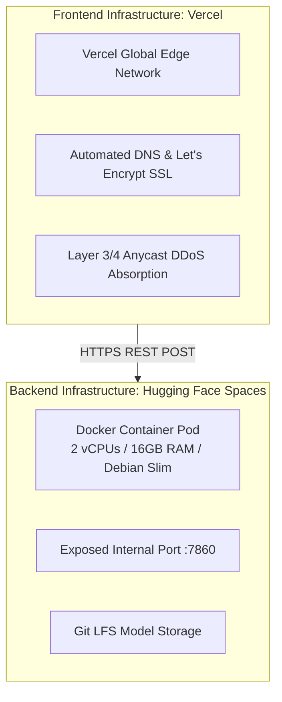

# Infrastructure Management & Cloud Governance: DeltaCare

**Document Version**: 1.0.0  
**Phase**: Pre-Development Foundation Phase  
**Author**: Senior DevOps Engineer & Platform Architect  
**Status**: Authoritative DevOps Baseline  
**Approved References**: [ADR-002](../decisions/002-zero-dollar-hosting-strategy.md)

---

## 1. Zero-Cost Infrastructure Manifest

DeltaCare's infrastructure is hosted entirely on **perpetual free cloud tiers** without credit cards or paid cloud subscriptions:

---

## 2. Infrastructure Specifications & Operational Bounds

| Infrastructure Layer | Hosting Provider | Hardware Tier | Monthly Cost | Operational Limits & Safety Buffers |
| :--- | :--- | :--- | :---: | :--- |
| **Edge Web CDN** | Vercel | Hobby Free Tier | **$0.00** | 100GB bandwidth/month (Safe buffer: DeltaCare bundle $< 200\text{KB}$). |
| **API Container** | Hugging Face Spaces | Free CPU Tier | **$0.00** | 2 vCPUs, **16GB RAM** (Safe buffer: runtime uses $< 600\text{MB}$, providing $26\times$ safety margin). |
| **Model Storage** | GitHub / HF Git LFS | Free Git LFS Tier | **$0.00** | Model artifact $\approx 10\text{MB}$ (Well within 1GB free LFS cap). |
| **Domain & SSL** | Vercel / HF | Managed Free Tier | **$0.00** | Automated TLS 1.3 certificate rotation. |

---

## 3. Infrastructure Safety & Change Restrictions

1. **No IaC Needed for Phase 1**: Complex Infrastructure-as-Code (Terraform / Pulumi) is intentionally prohibited in Phase 1 to prevent accidental provisioning of billable cloud resources.
2. **AI Agent Restriction**: AI coding agents are **categorically prohibited** from modifying cloud hosting tiers, adding cloud providers, or running commands that trigger cloud billing.
3. **Disaster Portability**: The entire backend is containerized in a portable `Dockerfile`, allowing instant failover to any alternative Docker host (e.g., Koyeb, Render, Railway free credits) within 15 minutes if Hugging Face policies change.

