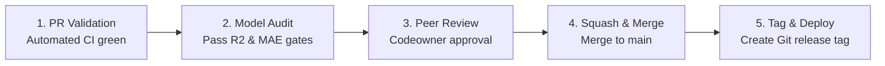

# Release Management & Change Governance: DeltaCare

**Document Version**: 1.0.0  
**Phase**: Pre-Development Foundation Phase  
**Author**: Senior DevOps Engineer & Platform Architect  
**Status**: Authoritative DevOps Baseline  

---

## 1. Release Lifecycle & Governance

Every production release of DeltaCare follows a structured 5-stage lifecycle:

---

## 2. Release Readiness Quality Gates

Before any pull request can be tagged and deployed to production, the release must satisfy all mandatory quality gates:

1. **Compilation & Type Gate**: Zero TypeScript errors (`tsc --noEmit`); zero Python typing errors (`mypy --strict`).
2. **Automated Test Gate**: 100% of unit, component, API contract, and security tests pass with exit code `0`.
3. **Statistical Quality Gate**: `scripts/audit_model.py` confirms $R^2 \ge 0.85$ and $\text{MAE} \le \$2,000.00$.
4. **Vulnerability Gate**: Zero Critical or High severity CVEs reported by `pip-audit` or `npm audit`.
5. **Documentation Gate**: All changed APIs or UX behaviors have matching updates in `docs/` and `docs/decisions/`.
6. **Zero Secrets Gate**: Secret scanning verifies no credentials or tokens are present in the commit diff.

---

## 3. Automated Release Tagging

Upon squash-merging to `main`, an automated GitHub Actions release workflow:
1. Calculates the next Semantic Version based on Conventional Commit prefixes (`fix` $\rightarrow$ PATCH, `feat` $\rightarrow$ MINOR, `BREAKING CHANGE` $\rightarrow$ MAJOR).
2. Generates an automated changelog summarizing pull requests and resolved issues.
3. Publishes an annotated Git release tag (e.g., `v1.0.0`) to the repository.

