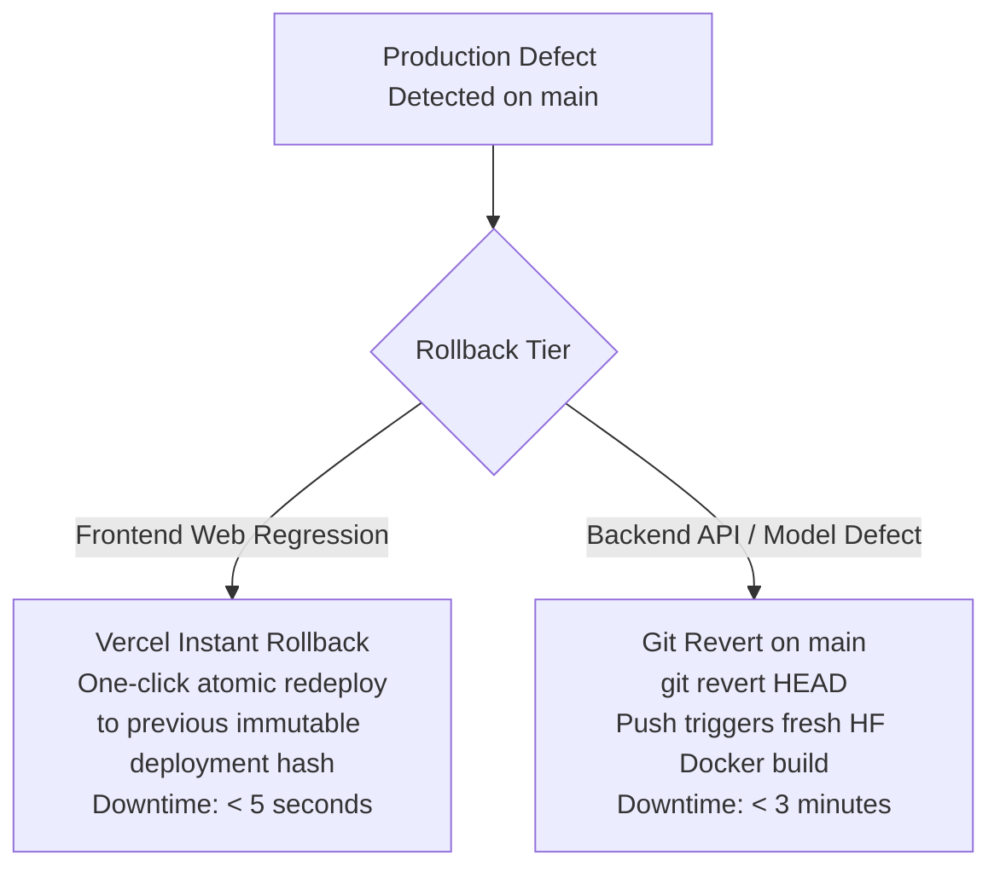

# Rollback Strategy & Incident Reversion: DeltaCare

**Document Version**: 1.0.0  
**Phase**: Pre-Development Foundation Phase  
**Author**: Senior DevOps Engineer & Platform Architect  
**Status**: Authoritative DevOps Baseline  

---

## 1. Rollback Architecture & Strategy

Because DeltaCare Phase 1 is completely stateless with zero database migrations, rollbacks are **rapid, safe, and atomic**:

---

## 2. Granular Rollback Procedures

### 2.1 Frontend Rollback Procedure (Vercel)
- **Mechanism**: Vercel preserves every previous deployment build as an immutable, globally cached hash.
- **Action**:
  1. Open Vercel Project Dashboard $\rightarrow$ Deployments.
  2. Locate the previous healthy deployment hash.
  3. Click **"Promote to Production"**.
- **Execution Time**: **$< 5$ seconds** (Zero recompilation required; instant Anycast pointer update).

### 2.2 Backend Rollback Procedure (Hugging Face Spaces)
- **Mechanism**: Git commit reversion triggering an automated Docker container rebuild.
- **Action**:
  1. Identify the failing commit hash on `main`.
  2. Execute Git revert locally: `git revert <commit_hash> -m 1`.
  3. Push revert commit to `main`.
  4. Hugging Face Spaces receives the webhook, rebuilds the previous healthy Docker container, and restarts port `7860`.
- **Execution Time**: **$< 3$ minutes**.

---

## 3. Rollback Invariants
- **Never Fix Forward Under Panic**: If a critical production bug (P1) is detected, execute an immediate rollback to the last verified healthy release tag first, before investigating the root cause.
- **Zero Data Loss**: Because the application is 100% stateless, rolling back code never risks database corruption or data loss.

