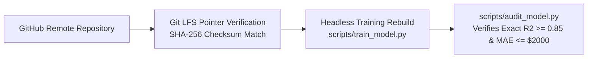

# Backup Verification & Data Asset Integrity: DeltaCare

**Document Version**: 1.0.0  
**Phase**: Pre-Development Foundation Phase  
**Author**: Site Reliability Engineer & Data Integrity Lead  
**Status**: Authoritative Operations Baseline  
**Approved References**: [ADR-003](../decisions/003-unified-sklearn-pipeline.md), [ADR-004](../decisions/004-stateless-b2c-mvp.md)

---

## 1. Backup Strategy: Code & ML Artifact Integrity

In Phase 1 (MVP), **there is no database to back up**.

Backup verification focuses exclusively on ensuring the **reproducibility and cryptographic integrity of our code, datasets, and machine learning artifacts**:

---

## 2. Backup Verification Protocols

### Protocol 1: Git LFS Model Checksum Audit
- **Frequency**: Automated on every continuous integration run.
- **Verification Command**: `git lfs verify` and `sha256sum apps/api/models/model.joblib`.
- **Pass Criteria**: SHA-256 hash matches the Git LFS pointer exactly, verifying zero bit rot or artifact corruption.

### Protocol 2: Headless Data Reconstruction Drill
- **Frequency**: Monthly automated workflow.
- **Action**: In an isolated temporary runner:
  1. Fetch raw data: `python scripts/ingest_data.py`.
  2. Re-train pipeline: `python scripts/train_model.py`.
  3. Audit holdout metrics: `python scripts/audit_model.py`.
- **Pass Criteria**: Newly trained pipeline matches holdout benchmarks within statistical variance without human intervention.

