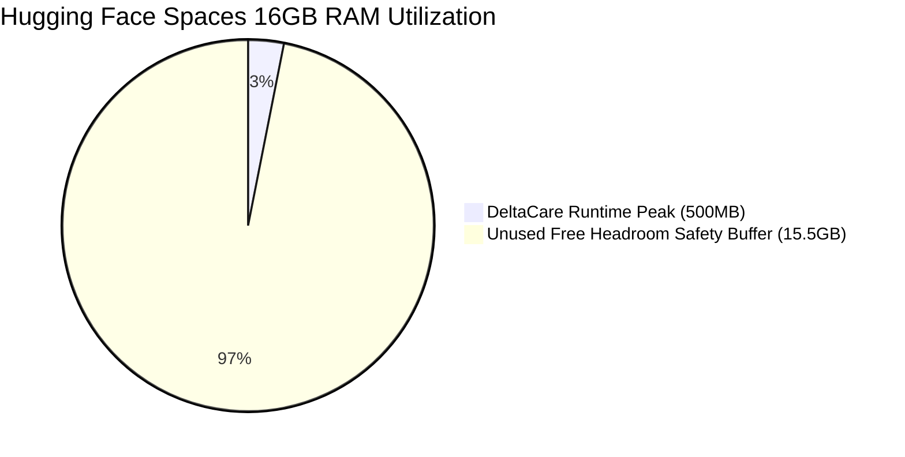

# Capacity Planning & Headroom Analysis: DeltaCare

**Document Version**: 1.0.0  
**Phase**: Pre-Development Foundation Phase  
**Author**: Site Reliability Engineer & Systems Architect  
**Status**: Authoritative Operations Baseline  
**Approved References**: [ADR-002](../decisions/002-zero-dollar-hosting-strategy.md)

---

## 1. Hardware Allocation & Headroom Analysis

DeltaCare is engineered to operate comfortably within free-tier resource boundaries:

| Resource Dimension | Allocated Capacity (Free Tier) | Peak Consumption (DeltaCare) | Headroom Safety Margin |
| :--- | :---: | :---: | :---: |
| **Backend Memory (RAM)** | **16.0 GB** (Hugging Face Spaces) | $\approx \mathbf{500\text{MB}}$ (Python + XGBoost) | **$32\times$ Memory Buffer** |
| **Backend Compute (CPU)** | **2 vCPUs** (Dedicated CPU core) | $\approx \mathbf{15\text{ms}}$ CPU time per inference | **~50–100 req/sec Capacity** |
| **Frontend Bandwidth** | **100 GB / month** (Vercel) | $\approx \mathbf{150\text{KB}}$ bundle per initial visitor | **~650,000 Pageviews / month** |
| **Model Storage** | **1.0 GB** (Git LFS Free Tier) | $\approx \mathbf{10\text{MB}}$ (`model.joblib`) | **$100\times$ Storage Buffer** |

---

## 2. Saturation Triggers & Growth Paths

If DeltaCare experiences massive viral traffic, operational scaling transitions occur according to predefined saturation triggers:

1. **Trigger: Backend CPU $> 85\%$ Sustained**:
   - *Cause*: Traffic exceeds 120 continuous requests/second.
   - *Mitigation*: Enable horizontal container scaling or migrate from free CPU tier to multi-core dedicated CPU space ($9/month) in Phase 2.
2. **Trigger: Vercel Bandwidth $> 80\text{GB}$ / month**:
   - *Cause*: Unique monthly visitors exceed 500,000.
   - *Mitigation*: Enable Cloudflare proxy caching in front of Vercel to cache static assets globally.

