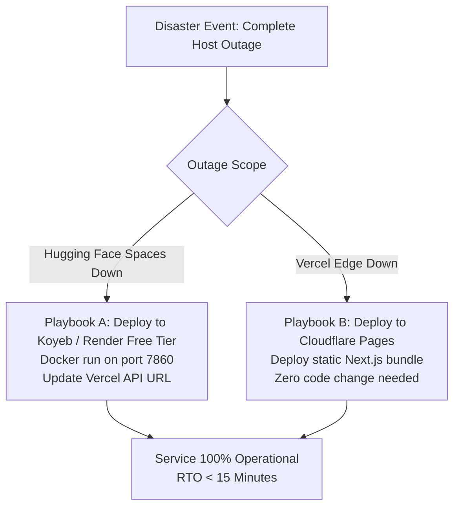

# Disaster Recovery & Platform Failover Runbook: DeltaCare

**Document Version**: 1.0.0  
**Phase**: Pre-Development Foundation Phase  
**Author**: Site Reliability Engineer & Platform Architect  
**Status**: Authoritative Operations Baseline  
**Approved References**: [ADR-002](../decisions/002-zero-dollar-hosting-strategy.md), [ADR-004](../decisions/004-stateless-b2c-mvp.md)

---

## 1. Disaster Recovery Objectives (RTO / RPO)

Because DeltaCare Phase 1 is completely stateless (zero database, zero PII retention), Disaster Recovery (DR) metrics are mathematically optimal:

- **Recovery Point Objective (RPO)**: **0 Seconds** (Zero user calculation data exists to lose).
- **Recovery Time Objective (RTO)**: **$< 15$ Minutes** (Time required to deploy the portable Docker container to any alternative cloud host).



---

## 2. Disaster Recovery Playbooks

### Playbook A: Hugging Face Spaces Complete Outage / Deletion
1. Clone the repository from GitHub: `git clone https://github.com/sayantan/DeltaCare.git`.
2. Rebuild the container on an alternative free Docker host (e.g., Koyeb, Render Free Web Service):
   ```bash
   docker build -t deltacare-api apps/api/
   docker run -p 7860:7860 -e PORT=7860 deltacare-api
   ```
3. Update `NEXT_PUBLIC_API_URL` in the Vercel project settings to the new container URL.
4. Redeploy Vercel edge frontend. Total recovery time: $< 15\text{ minutes}$.

### Playbook B: Vercel Complete Outage
1. Connect the `DeltaCare` GitHub repository to **Cloudflare Pages** or **Netlify**.
2. Set build command to `npm run build` with root directory `apps/web`.
3. Set environment variable `NEXT_PUBLIC_API_URL` pointing to the Hugging Face Space.
4. Deploy. Total recovery time: $< 10\text{ minutes}$.

