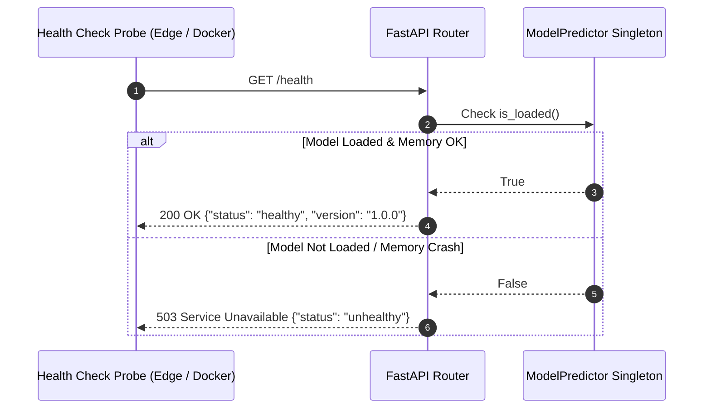

# Health Checks & Liveness Probing: DeltaCare

**Document Version**: 1.0.0  
**Phase**: Pre-Development Foundation Phase  
**Author**: Site Reliability Engineer & Production Operations Architect  
**Status**: Authoritative Operations Baseline  

---

## 1. Health Probe Specifications

DeltaCare implements two distinct health check mechanisms:
1. **Liveness Probe**: Verifies that the ASGI Uvicorn server is bound to port `7860` and serving requests.
2. **Readiness Probe**: Verifies that `model.joblib` has been successfully deserialized into RAM and is ready for inference.



---

## 2. API Contract: `GET /health`

### 2.1 Healthy Response
- **HTTP Status**: `200 OK`
- **Response Headers**: `Content-Type: application/json`
- **Response Body**:
  ```json
  {
    "status": "healthy",
    "version": "1.0.0",
    "environment": "production"
  }
  ```

### 2.2 Unhealthy Response
- **HTTP Status**: `503 Service Unavailable`
- **Response Body**:
  ```json
  {
    "status": "unhealthy",
    "error": "ML pipeline artifact not loaded into memory"
  }
  ```

---

## 3. Optimistic Client-Side Pre-Warming Protocol

- **Implementation**: The React hook `usePreWarm` fires a non-blocking `GET /health` call upon initial DOM mounting.
- **Network Setting**: Dispatched using `fetch(HEALTH_URL, { mode: 'cors', cache: 'no-store' })`.
- **Fail-Safe**: If the probe times out (container dormant), the promise fails silently in the background without throwing browser alerts, ensuring smooth form entry for the user.

