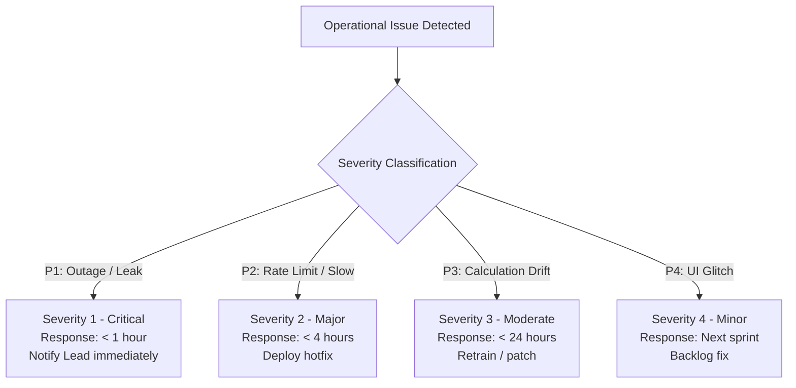

# Incident Management & SRE Escalation: DeltaCare

**Document Version**: 1.0.0  
**Phase**: Pre-Development Foundation Phase  
**Author**: Site Reliability Engineer & Production Operations Architect  
**Status**: Authoritative Operations Baseline  

---

## 1. Incident Severity Classification Matrix

When an operational defect occurs in production, it is classified into one of four standard SRE severity tiers:

| Severity Tier | Definition / Operational Impact | Response Time (SLA) | Primary Action Required |
| :--- | :--- | :---: | :--- |
| **P1 - Critical** | Total backend failure; container crash loop; secret leak on GitHub; CORS failure. | **Immediate ($< 1\text{ hour}$)** | Execute instant rollback or container restart; notify Lead. |
| **P2 - Major** | Extreme latency ($p95 > 2.0\text{s}$); continuous HTTP 429 surge; debounce misfiring. | **$< 4\text{ hours}$** | Inspect container RAM; tune rate limiter or debounce window. |
| **P3 - Moderate** | Model validation error bounds drifted; non-breaking UI styling glitch. | **$< 24\text{ hours}$** | Retrain pipeline via `scripts/train_model.py`; submit PR. |
| **P4 - Minor** | Documentation typo; minor log formatting defect. | **Next Release** | Standard issue tracking. |

---

## 2. SRE Incident Escalation & Post-Mortem Policy

1. **Escalation Path**:
   - Automated Alert $\rightarrow$ On-Call Engineer / AI Agent Lead $\rightarrow$ Technical Lead.
2. **Blameless Post-Mortem Policy**:
   - For every P1 or P2 incident, an engineering post-mortem must be documented in `docs/operations/incidents/`.
   - The post-mortem must identify: Timeline, Root Cause, Impact, What Went Well, What Went Poorly, and Action Items to prevent recurrence.

