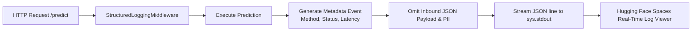

# Logging Strategy & Log Sanitization: DeltaCare

**Document Version**: 1.0.0  
**Phase**: Pre-Development Foundation Phase  
**Author**: Site Reliability Engineer & Application Security Architect  
**Status**: Authoritative Operations Baseline  
**Approved References**: [ADR-010](../decisions/010-structured-stdout-log-sanitization.md)

---

## 1. Structured JSON Logging Architecture

In compliance with Twelve-Factor App principles and free-tier container standards, DeltaCare streams structured JSON logs directly to **`stdout` / `stderr`**.



---

## 2. Structured Log Schema

Every HTTP transaction emitted by `apps/api/src/core/logger.py` adheres to this standardized JSON schema:

```json
{
  "timestamp": "2026-11-08T02:40:00Z",
  "level": "INFO",
  "service": "deltacare-api",
  "version": "1.0.0",
  "trace_id": "req-c8d1e2f3",
  "method": "POST",
  "path": "/predict",
  "status_code": 200,
  "duration_ms": 42.15,
  "client_ip_hash": "a1b2c3d4e5f6...",
  "error": null
}
```

---

## 3. Mandatory Log Sanitization Invariants

To guarantee that consumer privacy is never violated in production logs:
1. **Request Body Omission**: The inbound JSON payload containing `age`, `bmi`, `smoker`, `children`, `sex`, and `region` is **strictly excluded** from logging statements.
2. **IP Hash Protection**: Raw client IP addresses are hashed using a one-way salt or truncated (`192.0.2.xxx`) before being output.
3. **Zero Local File Storage**: Writing logs to local container files (e.g., `/var/log/app.log`) is **strictly prohibited** to prevent ephemeral container disk exhaustion.

