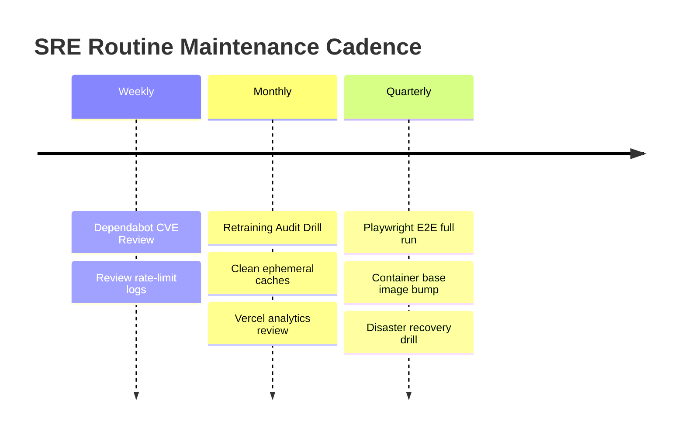

# Routine Maintenance Procedures: DeltaCare

**Document Version**: 1.0.0  
**Phase**: Pre-Development Foundation Phase  
**Author**: Site Reliability Engineer & Platform Architect  
**Status**: Authoritative Operations Baseline  

---

## 1. Routine Maintenance Cadence

To guarantee that DeltaCare remains secure, performant, and reliable over long-term operations, SRE maintenance is organized on a strict cadence:

---

## 2. Maintenance Runbooks

### Runbook 1: Monthly Dependency & Security Audit
1. Review open Dependabot pull requests across `apps/api` and `apps/web`.
2. Execute vulnerability scans: `pip-audit -r apps/api/requirements.txt` and `npm audit`.
3. Merge approved patch PRs and verify green status in GitHub Actions CI.

### Runbook 2: Model Retraining & Performance Baseline Check
1. Execute `python scripts/ingest_data.py` to check for dataset updates.
2. Run `python scripts/train_model.py`.
3. Verify that the newly serialized `model.joblib` satisfies `scripts/audit_model.py` ($R^2 \ge 0.85$, $\text{MAE} \le \$2,000$).
4. Commit updated artifact via Git LFS.

### Runbook 3: Ephemeral Container Cache Cleanup
1. In the Hugging Face Space console, review active container memory and logs.
2. Trigger a clean container rebuild if memory fragmentation or temporary `/tmp` artifacts exceed 500MB.

