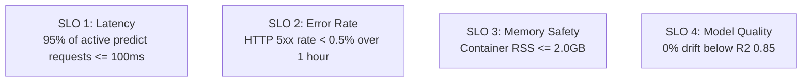

# Metrics & Alerting Thresholds: DeltaCare

**Document Version**: 1.0.0  
**Phase**: Pre-Development Foundation Phase  
**Author**: Site Reliability Engineer & Production Operations Architect  
**Status**: Authoritative Operations Baseline  

---

## 1. Service Level Indicators (SLIs) & Objectives (SLOs)

DeltaCare establishes pragmatic, measurable Service Level Objectives tailored to free-tier cloud architectures:

---

## 2. Key Operational Metrics Matrix

| Metric Category | Specific Indicator (SLI) | Healthy Target | Warning Threshold | Critical Alert Threshold |
| :--- | :--- | :---: | :---: | :---: |
| **API Latency** | $p95$ Request Latency | $\le 50\text{ms}$ | $> 100\text{ms}$ | $> 250\text{ms}$ (Active) |
| **Availability**| HTTP 2xx/3xx Success Rate | $\ge 99.5\%$ | $< 99.0\%$ | $< 95.0\%$ |
| **Error Rate** | HTTP 5xx Server Errors | $0.0\%$ | $> 0.5\%$ | $> 2.0\%$ |
| **Rate Throttling** | HTTP 429 Rate Limit Breaches | $< 5/\text{hour}$ | $> 25/\text{hour}$ | $> 100/\text{hour}$ (DDoS Alert) |
| **Container RAM** | Resident Set Size (RSS) | $\approx 500\text{MB}$ | $> 1.5\text{GB}$ | $> 2.5\text{GB}$ (OOM Risk) |
| **Container CPU** | 2 vCPU Core Utilization | $\le 20\%$ | $> 60\%$ | $> 85\%$ continuous |

---

## 3. Alerting Channels & Escalation Paths

- **Notification Medium**: Free GitHub commit/PR alerts and Hugging Face space status notifications forwarded to the Technical Lead's registered email.
- **Escalation Trigger**: If HTTP 5xx errors exceed 2.0% over a 15-minute window, trigger SRE Incident Playbook 1 (Container Restart & Revert).

