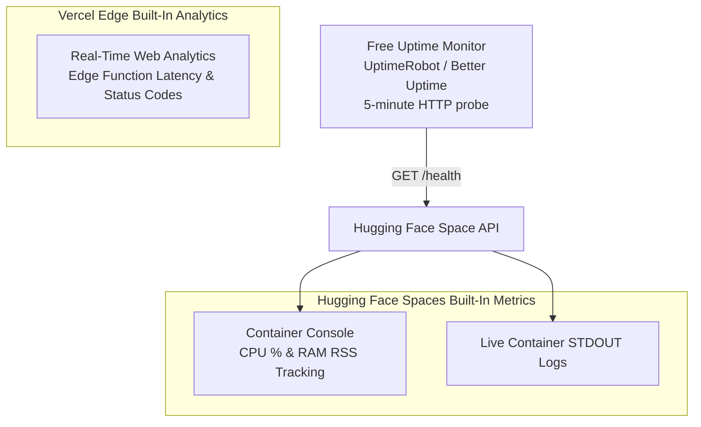

# Monitoring Strategy & Health Probes: DeltaCare

**Document Version**: 1.0.0  
**Phase**: Pre-Development Foundation Phase  
**Author**: Site Reliability Engineer & Production Operations Architect  
**Status**: Authoritative Operations Baseline  
**Approved References**: [ADR-002](../decisions/002-zero-dollar-hosting-strategy.md)

---

## 1. Zero-Cost Monitoring Topography

To maintain the **$0 perpetual budget**, DeltaCare avoids costly enterprise APMs and utilizes built-in platform observability paired with external free-tier ping probes:



---

## 2. Health Monitoring Probes

### 2.1 The Container Liveness Probe (`GET /health`)
- **Route**: `GET /health`
- **Execution**: Fast, in-memory status return ($< 5\text{ms}$).
- **Failure Condition**: If the route returns non-200 or times out ($> 5\text{s}$), the container is marked unhealthy.
- **Docker Integration**: Configured in `apps/api/Dockerfile` via `HEALTHCHECK`:
  ```dockerfile
  HEALTHCHECK --interval=30s --timeout=5s --start-period=10s --retries=3 \
    CMD curl -f http://localhost:7860/health || exit 1
  ```

### 2.2 Optional Free External Uptime Ping (Dormancy Preventer)
- Setting a free external ping monitor (e.g., UptimeRobot free tier) to probe `GET /health` every **30 minutes** provides two operational benefits:
  1. Instant notification if the backend container fails.
  2. Prevents the Hugging Face Space from entering its 48-hour dormancy sleep mode, maintaining a permanently warm instance.

