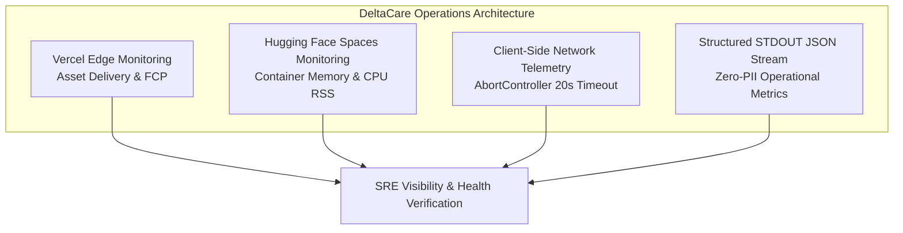

# Operations Overview & SRE Principles: DeltaCare

**Document Version**: 1.0.0  
**Phase**: Pre-Development Foundation Phase  
**Author**: Site Reliability Engineer & Production Operations Architect  
**Status**: Authoritative Operations Baseline  
**Approved References**: [ADR-002](../decisions/002-zero-dollar-hosting-strategy.md), [ADR-004](../decisions/004-stateless-b2c-mvp.md), [ADR-010](../decisions/010-structured-stdout-log-sanitization.md)

---

## 1. Operational Philosophy & Realities

Operating a production machine learning micro-SaaS under a **strict $0 perpetual budget** requires pragmatic Site Reliability Engineering (SRE):

1. **Pragmatic Availability Goals**:
   - We do not promise artificial "five nines" (99.999%) uptime on free-tier infrastructure.
   - **Frontend (Vercel Edge)**: High Availability Target $\approx \mathbf{99.9\%}$ (backed by Vercel's global Anycast edge network).
   - **Backend (Hugging Face Spaces)**: Operational Uptime Target $\approx \mathbf{99.0\%}$ (accounting for the 48-hour dormancy cold-start spin-up window).
2. **Stateless Resiliency Advantage**:
   - Because Phase 1 is completely stateless (zero database, zero persistent user state), operations are immune to data corruption, replication lag, or database deadlocks.
   - Any failing container can be instantly terminated and replaced with zero state reconciliation.
3. **In-Memory Observability**:
   - Free cloud tiers do not permit heavy external APM agents (Datadog/New Relic).
   - Observability is achieved through lightweight structured STDOUT logging, non-blocking health checks, and client-side performance telemetry.

---

## 2. Master Operations Documentation Index

All operational runbooks, monitoring plans, and incident procedures reside in `docs/operations/`:

| Document | Primary Scope | Operational Focus |
| :--- | :--- | :--- |
| [LOGGING_STRATEGY.md](LOGGING_STRATEGY.md) | Structured JSON logging to STDOUT | Zero-PII masking, latency tracking, log formatting. |
| [MONITORING_STRATEGY.md](MONITORING_STRATEGY.md) | Platform & application health monitoring | Free-tier monitoring bounds, UptimeRobot, liveness probes. |
| [METRICS_AND_ALERTING.md](METRICS_AND_ALERTING.md)| Key SRE metrics, SLIs/SLOs, and thresholds | CPU/RAM ceilings, error rate triggers, alert channels. |
| [HEALTH_CHECKS.md](HEALTH_CHECKS.md) | Probing specifications (`GET /health`) | Cold-start pre-warming mechanics and Docker `HEALTHCHECK`. |
| [INCIDENT_MANAGEMENT.md](INCIDENT_MANAGEMENT.md)| SRE incident triage, escalation, and post-mortems | P1 to P4 severity response workflows. |
| [DISASTER_RECOVERY.md](DISASTER_RECOVERY.md) | DR playbooks, failover runbooks, RTO/RPO | $< 15\text{m}$ RTO, $0\text{s}$ RPO deterministic Git restoration. |
| [BACKUP_VERIFICATION.md](BACKUP_VERIFICATION.md)| Verification protocols for code, models, and configs | Git LFS checksum audit, deterministic training seeds. |
| [CAPACITY_PLANNING.md](CAPACITY_PLANNING.md) | Hardware headroom analysis & growth limits | 16GB RAM buffer evaluation, 60 req/min limits. |
| [MAINTENANCE_PROCEDURES.md](MAINTENANCE_PROCEDURES.md)| Routine maintenance runbooks | Monthly dependency bumps, model re-training cycles. |
| [TROUBLESHOOTING_GUIDE.md](TROUBLESHOOTING_GUIDE.md)| Runbook for common failure modes | Cold-start delays, HTTP 429 surges, CORS rejections. |
| [RELEASE_OPERATIONS.md](RELEASE_OPERATIONS.md) | Zero-downtime release deployments & rollbacks | Atomic Vercel CDN promotion, Docker tag sync. |

---

## 3. Operational Invariants for AI Coding Agents

When performing maintenance, refactoring, or operational tasks, AI agents must:
- **Preserve Operational Visibility**: Never suppress error logs, disable health check routes, or remove structured log middleware.
- **Never Modify Monitoring Thresholds Silently**: Changing rate limits, memory ceilings, or timeout windows requires explicit Technical Lead approval.
- **No Destructive Maintenance**: Deleting model artifacts, purging Git history, or reconfiguring platform webhooks must never be performed autonomously.

