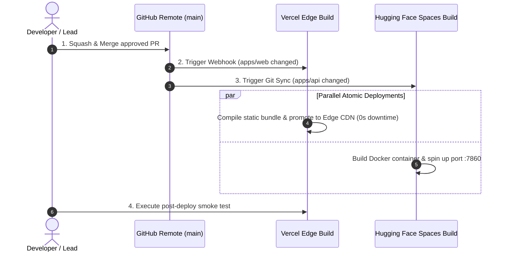

# Release Operations & Deployment Runbook: DeltaCare

**Document Version**: 1.0.0  
**Phase**: Pre-Development Foundation Phase  
**Author**: Site Reliability Engineer & Release Manager  
**Status**: Authoritative Operations Baseline  
**Approved References**: [ADR-001](../decisions/001-decoupled-monorepo.md), [ADR-002](../decisions/002-zero-dollar-hosting-strategy.md)

---

## 1. Zero-Downtime Deployment Runbook

Deployments in DeltaCare execute automatically via Git webhooks upon merging into the protected `main` branch.



---

## 2. Step-by-Step Release Operations

### Step 1: Pre-Flight Verification (Local Runner)
1. Verify clean Git status on `main`: `git status`.
2. Execute full local verification:
   ```bash
   pytest apps/api/tests/
   npm --prefix apps/web test
   python scripts/audit_model.py
   ```
3. Confirm all tests exit with status `0`.

### Step 2: Merge & Automated Build
1. Merge pull request to `main` using **Squash and Merge**.
2. Monitor GitHub Actions CI workflows: confirm `api-ci`, `web-ci`, and `model-audit` are green.
3. Monitor Vercel and Hugging Face deployment dashboards for clean container builds.

### Step 3: Post-Deployment Smoke Verification
1. Access production portal: `https://deltacare.vercel.app`.
2. Inspect browser network tab: verify `GET /health` returns `200 OK`.
3. Submit calculation with Age `35`, BMI `28.0`, Smoker `yes`.
4. Verify primary quote, What-If smoking delta badge, and non-binder legal disclaimer render properly.

### Step 4: Emergency Abort / Rollback
- If unexpected errors occur in production, execute immediate rollback per [`docs/devops/ROLLBACK_STRATEGY.md`](../devops/ROLLBACK_STRATEGY.md) (Promote previous immutable deployment on Vercel; revert Git commit on Hugging Face).

