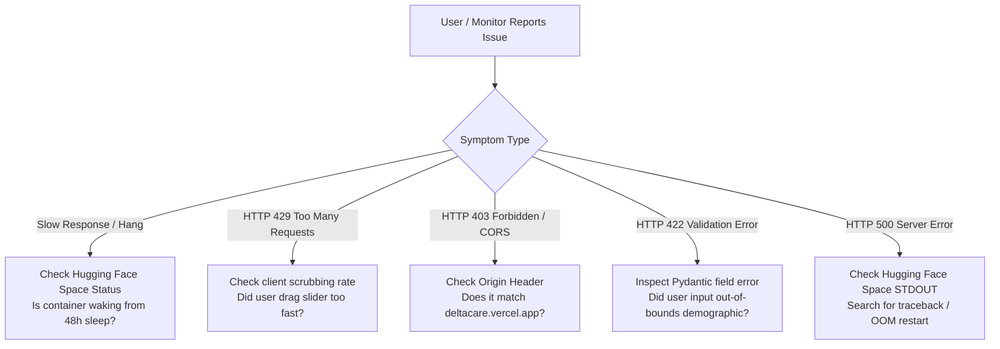

# Operational Troubleshooting Runbook: DeltaCare

**Document Version**: 1.0.0  
**Phase**: Pre-Development Foundation Phase  
**Author**: Site Reliability Engineer & Support Architect  
**Status**: Authoritative Operations Baseline  

---

## 1. Fast-Triage Diagnostic Decision Tree

---

## 2. Common Operational Failure Modes & Resolutions

### Symptom 1: 15-Second Delay on First Quote Submission
- **Root Cause**: Hugging Face Spaces free-tier container was dormant after 48 hours of inactivity and spun up on the incoming request.
- **Verification**: Check Hugging Face console status (shows *"Starting container"*).
- **Resolution**: Expected behavior on free tier; client-side staged loading states (spinner $\rightarrow$ skeleton) mask this delay. Consider setting up a free 30-minute ping via UptimeRobot to keep the container permanently warm.

### Symptom 2: HTTP 429 "Too Many Requests" Error
- **Root Cause**: Client IP submitted $> 60\text{ requests}$ within a 60-second window.
- **Verification**: Check response headers for `Retry-After: 60`.
- **Resolution**: Wait 60 seconds for the in-memory token bucket to refill. Ensure the frontend debounce hook is operating with a 400ms delay.

### Symptom 3: CORS Rejection in Browser Console
- **Root Cause**: Request sent from unauthorized domain or local development port changed from `3000`.
- **Verification**: Browser console reports: *"No 'Access-Control-Allow-Origin' header is present"*.
- **Resolution**: Add the client origin to `CORS_ORIGINS` in `apps/api/.env` or Hugging Face Space environment settings.

### Symptom 4: Container Crashed / Out of Memory
- **Root Cause**: Unexpected memory leak or process death.
- **Verification**: Hugging Face Spaces displays status *"Crashed / Error"*.
- **Resolution**: Inspect container STDOUT log for traceback. Restart space via console.

