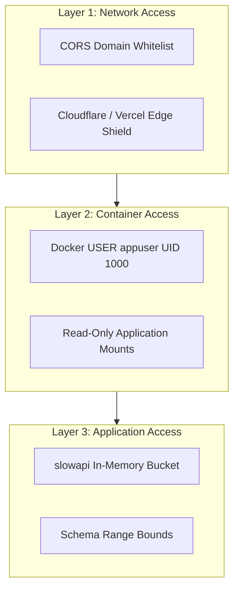

# Access Control Policy: DeltaCare

**Document Version**: 1.0.0  
**Phase**: Pre-Development Foundation Phase  
**Author**: Senior Application Security Architect  
**Status**: Authoritative Security Baseline  

---

## 1. System Access Control Layers

DeltaCare enforces access controls across network, host, container, and application layers:



---

## 2. Granular Access Control Standards

### 2.1 Container Access Control (`apps/api/Dockerfile`)
- **Non-Root Execution**: The container must never execute as `root`.
  ```dockerfile
  # Dockerfile standard
  RUN useradd -m -u 1000 appuser
  USER appuser
  ```
- **Filesystem Permissions**: The application directory is owned by `appuser` with read/execute permissions (`0555`). Write access is restricted exclusively to ephemeral `/tmp` if required.

### 2.2 Cross-Origin Resource Sharing (CORS) Configuration
```python
# apps/api/src/main.py configuration
from fastapi.middleware.cors import CORSMiddleware

app.add_middleware(
    CORSMiddleware,
    allow_origins=[
        "https://deltacare.vercel.app",  # Production Vercel Domain
        "http://localhost:3000",         # Local Development
        "http://127.0.0.1:3000"
    ],
    allow_credentials=False,             # Zero cookies/credentials allowed
    allow_methods=["GET", "POST", "OPTIONS"],
    allow_headers=["Content-Type", "Accept"],
    max_age=86400                        # Cache preflight for 24 hours
)
```

### 2.3 Repository Access Control (GitHub)
- **Branch Protection**: The `main` branch enforces mandatory PR reviews and passing CI/CD status checks.
- **Push Protection**: Direct pushes to `main` are blocked; GitHub secret scanning is enabled on the repository.

