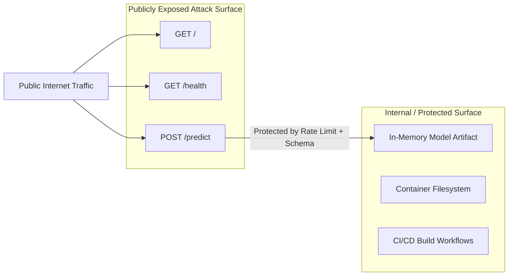

# Attack Surface Analysis: DeltaCare

**Document Version**: 1.0.0  
**Phase**: Pre-Development Foundation Phase  
**Author**: Senior Application Security Architect  
**Status**: Authoritative Security Baseline  

---

## 1. Attack Surface Inventory

DeltaCare maintains a radically reduced attack surface by operating without databases, user accounts, or administrative dashboards.

---

## 2. Public Entrypoint Evaluation

| Entrypoint | Protocol | Exposed Port | Purpose | Exposure Level | Primary Defensive Control |
| :--- | :--- | :--- | :--- | :---: | :--- |
| **`GET /`** (Frontend) | HTTPS | 443 | Serves static Next.js SPA bundle | Public | Vercel Edge CDN DDoS protection & static file immutability. |
| **`GET /health`** (API) | HTTPS | 7860/443 | Service liveness probe & pre-warming | Public | Returns static JSON; zero database queries or computation. |
| **`POST /predict`** (API)| HTTPS | 7860/443 | Quoting calculation endpoint | Public | CORS origin whitelist + slowapi rate limit (60 req/min) + Pydantic schema validation. |
| **All Other Routes** | Any | Any | N/A | **CLOSED** | Returns HTTP 404 / 405. Zero admin portals, Swagger docs (disabled in prod), or metrics endpoints exposed. |

---

## 3. Attack Surface Reduction Techniques Applied

1. **Disabled API Documentation in Production**:
   - FastAPI automatically generates `/docs` (Swagger UI) and `/redoc`.
   - **Security Policy**: In production (`ENVIRONMENT=production`), Swagger UI and OpenAPI documentation endpoints are explicitly disabled (`docs_url=None`, `redoc_url=None`) to prevent endpoint enumeration.
2. **Elimination of Administrative Interfaces**:
   - Zero `/admin/` portals, backend shells, or debug routes exist in the codebase.
3. **Stateless Request Processing**:
   - Requests are processed in volatile RAM and immediately discarded. Attackers cannot leverage stored XSS, second-order SQL injection, or server-side request forgery (SSRF).
4. **Strict HTTP Method Restrictions**:
   - The API explicitly rejects `PUT`, `DELETE`, `PATCH`, `TRACE`, and `CONNECT` methods at the router level.

