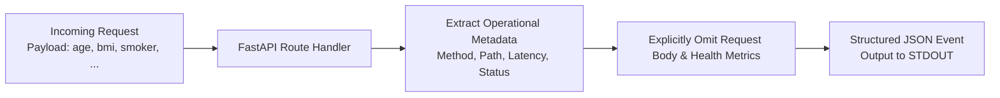

# Audit Logging & Log Sanitization: DeltaCare

**Document Version**: 1.0.0  
**Phase**: Pre-Development Foundation Phase  
**Author**: Senior Application Security Architect  
**Status**: Authoritative Security Baseline  
**Approved References**: [ADR-010](../decisions/010-structured-stdout-log-sanitization.md)

---

## 1. Zero-PII Structured Logging Policy

Application logs must provide operational visibility into service health, latency, and error rates **without capturing consumer health data or personal identifiers**.



---

## 2. Logger Implementation Specification (`apps/api/src/core/logger.py`)

```python
import json
import logging
import sys
import time
from fastapi import Request, Response
from starlette.middleware.base import BaseHTTPMiddleware

class StructuredLoggingMiddleware(BaseHTTPMiddleware):
    async def dispatch(self, request: Request, call_next):
        start_time = time.time()
        response: Response = await call_next(request)
        process_time_ms = round((time.time() - start_time) * 1000, 2)

        # Structured log record with ZERO PII
        log_record = {
            "timestamp": time.strftime("%Y-%m-%dT%H:%M:%SZ", time.gmtime()),
            "level": "INFO" if response.status_code < 400 else "ERROR",
            "method": request.method,
            "path": request.url.path,
            "status_code": response.status_code,
            "duration_ms": process_time_ms,
            "client_ip_hash": hash(request.client.host) if request.client else None
            # NOTICE: request body and user features are EXCLUDED
        }

        # Stream directly to STDOUT as single-line JSON
        sys.stdout.write(json.dumps(log_record) + "\n")
        sys.stdout.flush()
        return response
```

---

## 3. Log Invariants & Prohibitions

1. **PROHIBITED in Logs**:
   - Age, BMI, smoker status, dependent counts, or region.
   - Raw consumer IP addresses (must be hashed or omitted).
   - Authorization headers or Bearer tokens.
   - Raw unhandled Python stack traces exposing internal environment paths.
2. **ALLOWED in Logs**:
   - HTTP method, URL path, response status code, and latency in milliseconds.
   - Memory utilization metrics and container startup event indicators.

