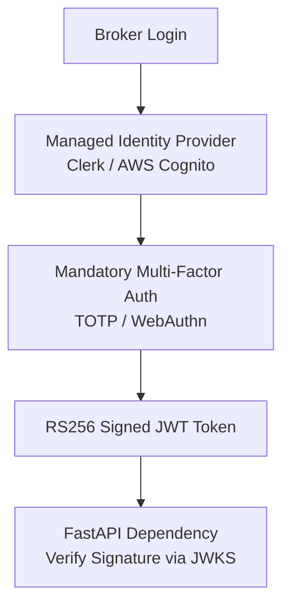

# Authentication Security Policy: DeltaCare

**Document Version**: 1.0.0  
**Phase**: Pre-Development Foundation Phase  
**Author**: Senior Application Security Architect  
**Status**: Authoritative Security Baseline  
**Approved References**: [ADR-004](../decisions/004-stateless-b2c-mvp.md)

---

## 1. Phase 1 Policy: Public Zero-Authentication Standard

In Phase 1 (MVP), **DeltaCare deliberately enforces a Zero-Authentication model**.

### 1.1 Architectural Rationale & Risk Analysis
- **OWASP ASVS Compliance**: Attempting to implement custom authentication (passwords, JWT cookies) for a simple public estimation tool introduces massive security liabilities:
  - Password storage and hashing risks (bcrypt/Argon2 tuning).
  - Session fixation and CSRF vulnerabilities.
  - Credential stuffing and brute-force account lockout headaches.
- **Privacy Advantage**: By requiring zero credentials, DeltaCare eliminates all credential theft risks and user account enumeration vectors.

---

## 2. Phase 2 Standards: Planned Broker Authentication (B2B Expansion)

When Phase 2 introduces authentication for licensed insurance brokers, the implementation must adhere to strict enterprise standards:

### 2.1 Non-Negotiable Phase 2 Authentication Standards
1. **Delegated Identity Management**: Zero custom password hashing or local user credential storage. Authentication must be delegated to a certified identity provider (Clerk, Auth0, or Cognito).
2. **Cryptographic Algorithm**: Tokens must use asymmetric signing (**`RS256`**). Symmetric `HS256` tokens with shared secrets are prohibited.
3. **Key Rotation & JWKS**: The backend API must verify tokens using the provider's JSON Web Key Set (JWKS) URL with automated key caching and rotation.
4. **Token Expiration**: Access tokens must have a maximum lifetime of **15 minutes**. Refresh tokens must enforce rotation and reuse detection.
5. **Multi-Factor Authentication (MFA)**: Mandatory MFA for all licensed broker accounts.

