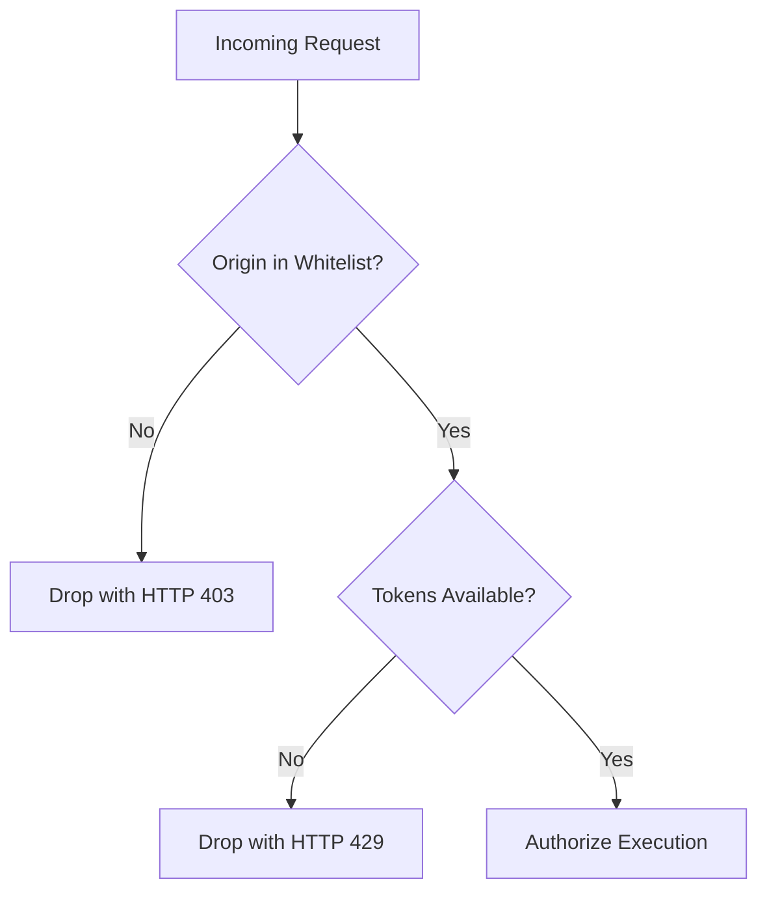

# Authorization Policy & Access Control: DeltaCare

**Document Version**: 1.0.0  
**Phase**: Pre-Development Foundation Phase  
**Author**: Senior Application Security Architect  
**Status**: Authoritative Security Baseline  
**Approved References**: [ADR-004](../decisions/004-stateless-b2c-mvp.md), [ADR-005](../decisions/005-in-memory-token-bucket-rate-limiting.md)

---

## 1. Phase 1 Policy: Boundary Authorization

In Phase 1 (MVP), authorization is evaluated at the **Network and Origin Boundary**:



### 1.1 Boundary Authorization Controls
- **Origin Authorization**: Enforced via FastAPI `CORSMiddleware`. Only requests presenting an `Origin` matching the verified Vercel production domain (or `localhost:3000` in development) are authorized to access the `/predict` route.
- **Quota Authorization**: Enforced via `slowapi`. Each client IP is authorized for up to 60 prediction operations per minute.

---

## 2. Phase 2 Policy: Role-Based Access Control (RBAC) (Planned B2B)

When Phase 2 introduces multi-tenant broker agencies, authorization will follow the **Principle of Least Privilege (PoLP)**:

### 2.1 Role & Permission Matrix (Phase 2 Target)

| Role | Quoting API (`/predict`) | Save Quote (`/quotes`) | View Own Clients | View Agency Portfolio | Manage Agency Seats |
| :--- | :---: | :---: | :---: | :---: | :---: |
| **Anonymous Public** | **ALLOW** | DENY (401) | DENY (401) | DENY (401) | DENY (401) |
| **Licensed Broker** | **ALLOW** | **ALLOW** | **ALLOW** | DENY (403) | DENY (403) |
| **Agency Admin** | **ALLOW** | **ALLOW** | **ALLOW** | **ALLOW** | **ALLOW** |

### 2.2 Broken Object-Level Authorization (BOLA / IDOR) Defense
- In Phase 2, whenever a broker queries `/api/v2/quotes/:id`, the SQL query must enforce a tenant boundary:
  ```sql
  SELECT * FROM quotes WHERE id = :quote_id AND broker_id = :current_user_id;
  ```
- Looking up records by ID alone without tenant checks is strictly prohibited to prevent Insecure Direct Object Reference (IDOR) vulnerabilities.

