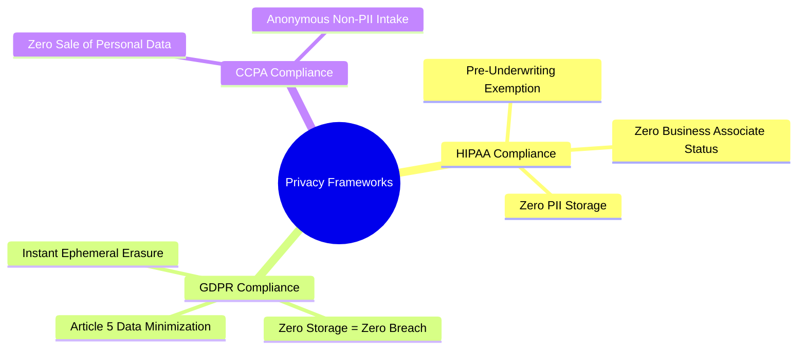

# Data Privacy & Regulatory Compliance: DeltaCare

**Document Version**: 1.0.0  
**Phase**: Pre-Development Foundation Phase  
**Author**: Senior Privacy Architect & Compliance Lead  
**Status**: Authoritative Security Baseline  
**Approved References**: [ADR-004](../decisions/004-stateless-b2c-mvp.md), [ADR-010](../decisions/010-structured-stdout-log-sanitization.md)

---

## 1. Regulatory Posture & Compliance Analysis

Because DeltaCare processes user demographic inputs that touch on health attributes (BMI, tobacco use), its privacy architecture is evaluated against international data protection frameworks:

---

## 2. Framework-Specific Compliance Details

### 2.1 Health Insurance Portability and Accountability Act (HIPAA)
- **Covered Entity Status**: DeltaCare in Phase 1 is an **informational consumer estimation tool**, not a covered healthcare provider, health plan clearinghouse, or Business Associate under 45 CFR § 160.103.
- **Protected Health Information (PHI)**: PHI is individually identifiable health information held by a covered entity. Because DeltaCare **never collects individual identifiers** (no names, SSNs, medical records, or addresses), user inputs do not constitute PHI under HIPAA.

### 2.2 General Data Protection Regulation (GDPR) & California Consumer Privacy Act (CCPA)
- **Data Minimization (GDPR Article 5(1)(c))**: DeltaCare requests only the 6 standard actuarial attributes strictly necessary to compute the mathematical regression formula.
- **Storage Limitation (GDPR Article 5(1)(e))**: DeltaCare satisfies storage limitation natively by enforcing a **0-millisecond retention period**; data is held only in volatile process RAM during the execution of `predict()` and discarded upon function return.
- **Right to Erasure (Article 17)**: Fully satisfied because no records are committed to persistent storage.
- **Zero Sale of Consumer Data**: DeltaCare does not sell, trade, or monetize user input data.

---

## 3. Statutory Consumer Disclaimer Requirement

To eliminate consumer confusion and reinforce that DeltaCare provides statistical estimations rather than binding insurance underwriting, every calculation view must display the mandatory disclaimer:

> *"Estimates are generated by a machine learning model for informational purposes only. This does not constitute an official quote, offer, or insurance binder. Actual premiums are determined by underwriting."*

