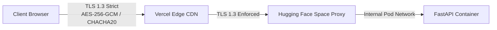

# Cryptography & Encryption Policy: DeltaCare

**Document Version**: 1.0.0  
**Phase**: Pre-Development Foundation Phase  
**Author**: Senior Cryptographic & Security Architect  
**Status**: Authoritative Security Baseline  

---

## 1. Cryptographic Standards Overview

All cryptographic protocols implemented across DeltaCare must comply with **NIST SP 800-52 Rev. 2** (Guidelines for the Selection, Configuration, and Use of TLS Implementations) and **FIPS 140-3** validated cipher suites.



---

## 2. Encryption in Transit (Data-in-Motion)

1. **Protocol Standards**:
   - **TLS 1.3** is the mandatory default across all public entrypoints.
   - **TLS 1.2** is permitted strictly as a fallback for legacy clients, restricted to secure cipher suites:
     - `TLS_ECDHE_ECDSA_WITH_AES_256_GCM_SHA384`
     - `TLS_ECDHE_RSA_WITH_AES_256_GCM_SHA384`
   - TLS 1.0, TLS 1.1, and all CBC-mode ciphers are **strictly rejected**.
2. **HTTP Strict Transport Security (HSTS)**:
   - All responses from Vercel Edge include the HSTS header:
     ```http
     Strict-Transport-Security: max-age=63072000; includeSubDomains; preload
     ```
3. **Automated Certificate Lifecycle**:
   - TLS certificates are provisioned and automatically renewed via Let's Encrypt managed infrastructure on Vercel and Hugging Face. Zero manual certificate or private key management is required.

---

## 3. Encryption at Rest (Data-at-Rest) & Integrity Verification

1. **Phase 1 Inactive Data Policy**:
   - Because Phase 1 is completely stateless, zero consumer calculation records exist on disk.
2. **Model Artifact Integrity (Git LFS)**:
   - The serialized machine learning pipeline (`model.joblib`) is verified using cryptographic **SHA-256 digests** via Git LFS pointers.
   - Any unauthorized bit-level modification or tampering with the model file triggers an immediate Git checksum mismatch.
3. **Phase 2 Target Database Encryption**:
   - When PostgreSQL is provisioned in Phase 2, tablespace storage must be encrypted at rest using **AES-256**.

