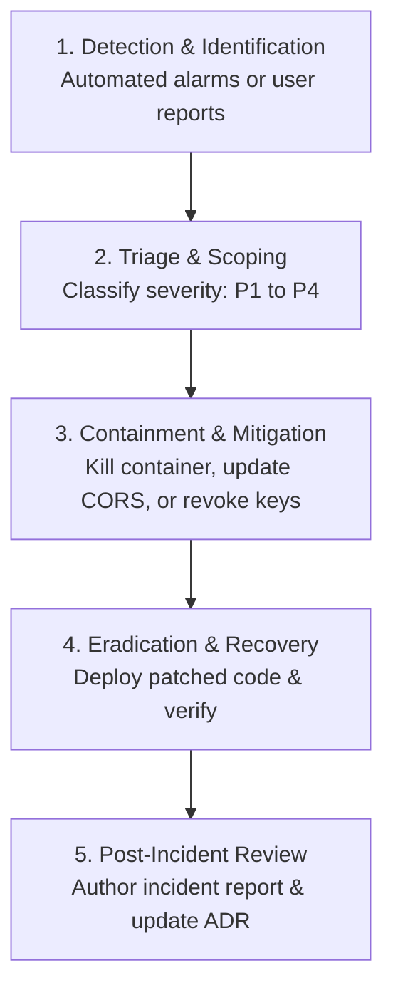

# Incident Response Plan (NIST SP 800-61 Rev. 2): DeltaCare

**Document Version**: 1.0.0  
**Phase**: Pre-Development Foundation Phase  
**Author**: Senior Application Security Architect  
**Status**: Authoritative Security Baseline  

---

## 1. Five-Phase Incident Response Lifecycle

DeltaCare adapts the **NIST SP 800-61 Rev. 2** framework for serverless and containerized micro-products:

---

## 2. Severity Classification Matrix

| Severity Level | Definition / Criteria | Response Target | Example Scenario |
| :--- | :--- | :---: | :--- |
| **P1 - Critical** | Direct code execution (RCE), leaked repository credentials, or complete service outage. | Immediate ($< 1\text{ hour}$) | Secret token pushed to GitHub; malicious package injected in dependencies. |
| **P2 - High** | Total failure of rate limiting; continuous container crashing; CORS policy bypass. | $< 4\text{ hours}$ | Botnet flooding Hugging Face Space causing 100% CPU starvation. |
| **P3 - Medium** | Incorrect mathematical calculation output; regression gate benchmark failure. | $< 24\text{ hours}$ | Model predicts negative charges on edge-case inputs. |
| **P4 - Low** | Minor visual defect, non-security logging glitch, or documentation typo. | Next Sprint | Debounce slider visual stutter. |

---

## 3. Incident Playbooks

### Playbook 1: Accidental Secret Leakage on GitHub
1. **Rotate Immediately**: Invalidate the leaked secret at the provider console (e.g., Hugging Face access token).
2. **Purge Git History**: Rewrite repository history using BFG Repo-Cleaner or `git-filter-repo` to permanently remove the commit from all branch refs.
3. **Audit Access Logs**: Review provider audit logs for unauthorized activity during the exposure window.

### Playbook 2: Distributed Denial of Service (Container Starvation)
1. **Verify Rate Limiting**: Check if traffic is bypassing `slowapi` or rotating across distributed IP blocks.
2. **Origin Hardening**: Verify FastAPI `CORSMiddleware` is strictly rejecting missing/unauthorized `Origin` headers.
3. **Emergency Action**: Temporarily reduce rate-limit ceiling to 30 req/min in `apps/api/src/core/limiter.py` and redeploy.

