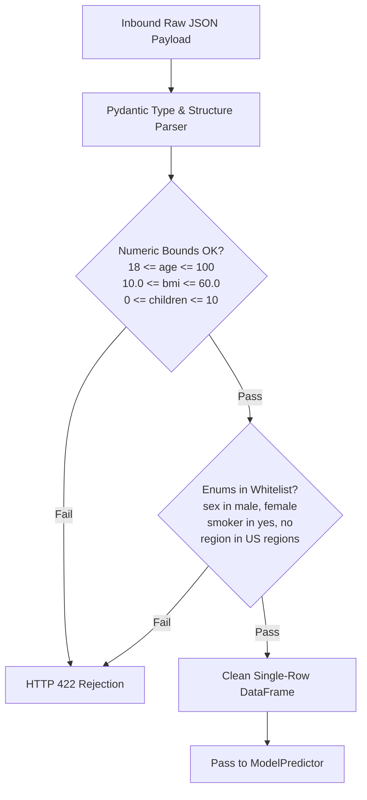

# Input Validation & Sanitization: DeltaCare

**Document Version**: 1.0.0  
**Phase**: Pre-Development Foundation Phase  
**Author**: Senior Application Security Architect  
**Status**: Authoritative Security Baseline  

---

## 1. Input Validation Strategy

DeltaCare implements **Strict Positive Input Validation (Allow-listing)**. Every inbound attribute is validated against rigid data types, numerical boundaries, and discrete enumeration sets before entering the application core.



---

## 2. Pydantic Validation Specifications (`apps/api/src/schemas/quote.py`)

```python
from typing import Literal
from pydantic import BaseModel, Field, validator

class QuoteRequest(BaseModel):
    age: int = Field(
        ...,
        ge=18,
        le=100,
        description="Age of the primary beneficiary (18-100)"
    )
    sex: Literal["male", "female"] = Field(
        ...,
        description="Biological sex of the insurance contractor"
    )
    bmi: float = Field(
        ...,
        ge=10.0,
        le=60.0,
        description="Body Mass Index in kg/m^2 (10.0-60.0)"
    )
    children: int = Field(
        ...,
        ge=0,
        le=10,
        description="Number of dependents covered under the plan (0-10)"
    )
    smoker: Literal["yes", "no"] = Field(
        ...,
        description="Tobacco use status"
    )
    region: Literal["northeast", "southeast", "southwest", "northwest"] = Field(
        ...,
        description="Residential territory in the United States"
    )

    class Config:
        # Rejects unexpected extra fields submitted by an attacker
        extra = "forbid"
        schema_extra = {
            "example": {
                "age": 35,
                "sex": "male",
                "bmi": 28.5,
                "children": 2,
                "smoker": "no",
                "region": "northwest"
            }
        }
```

---

## 3. Defense Against Injection Vectors

1. **SQL Injection (SQLi)**: Completely mitigated natively because Phase 1 has zero SQL database connections.
2. **Command Injection**: User inputs are never passed to shell commands, `eval()`, `exec()`, or sub-process calls.
3. **NoSQL / Object Injection**: Inputs are converted to a structured Pandas DataFrame containing purely numerical floats and categorical strings; no dynamic queries are assembled.
4. **Mass Assignment**: The Pydantic configuration `extra = "forbid"` causes the gateway to reject requests containing extraneous or unexpected fields, preventing mass assignment attacks.

