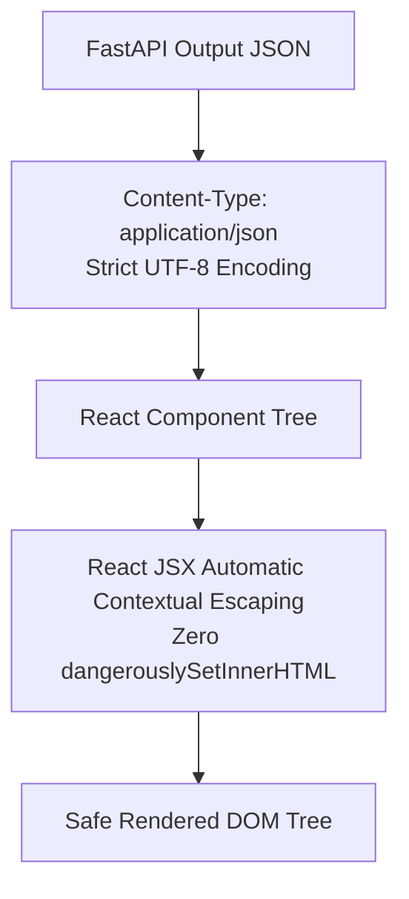

# Output Encoding & Content Security Policy (CSP): DeltaCare

**Document Version**: 1.0.0  
**Phase**: Pre-Development Foundation Phase  
**Author**: Senior Application Security Architect  
**Status**: Authoritative Security Baseline  

---

## 1. Cross-Site Scripting (XSS) Defenses

DeltaCare eliminates Cross-Site Scripting (XSS) vulnerabilities through three complementary controls:
1. **Context-Aware Output Encoding (React JSX)**.
2. **Strict Content-Type Headers on API Responses**.
3. **Hardened HTTP Content Security Policy (CSP)**.



---

## 2. React JSX Automatic Escaping Standard

- React natively escapes all variables rendered inside JSX expressions (`{predictedMonthly}`) before injecting them into the DOM, converting HTML control characters (`<`, `>`, `&`, `"`, `'`) to their safe entity equivalents.
- **Prohibited React Practices**:
  - The use of `dangerouslySetInnerHTML` is **strictly prohibited** anywhere in `apps/web/`.
  - Direct DOM manipulation via `document.write()`, `element.innerHTML`, or `eval()` is strictly prohibited.

---

## 3. Recommended Content Security Policy (CSP) Headers

The Next.js frontend deployed on Vercel must emit modern security headers via `apps/web/next.config.js`:

```javascript
// Recommended Security Headers in apps/web/next.config.js
const securityHeaders = [
  {
    key: 'Content-Security-Policy',
    value: `
      default-src 'self';
      script-src 'self' 'unsafe-inline';
      style-src 'self' 'unsafe-inline';
      img-src 'self' data: https:;
      connect-src 'self' https://*.hf.space;
      font-src 'self';
      frame-ancestors 'none';
      base-uri 'self';
      form-action 'self';
    `.replace(/\s{2,}/g, ' ').trim()
  },
  {
    key: 'X-Frame-Options',
    value: 'DENY'
  },
  {
    key: 'X-Content-Type-Options',
    value: 'nosniff'
  },
  {
    key: 'Referrer-Policy',
    value: 'strict-origin-when-cross-origin'
  },
  {
    key: 'Permissions-Policy',
    value: 'camera=(), microphone=(), geolocation=()'
  }
];
```

### 3.1 Explanation of Security Headers
- **`connect-src https://*.hf.space`**: Authorizes the React client to make fetch requests exclusively to our backend Hugging Face Space, blocking exfiltration to rogue third-party endpoints.
- **`X-Frame-Options: DENY`**: Protects the application from Clickjacking attacks by forbidding framing inside `<iframe>` tags on external sites.
- **`X-Content-Type-Options: nosniff`**: Prevents MIME-type confusion sniffing attacks by the browser.

