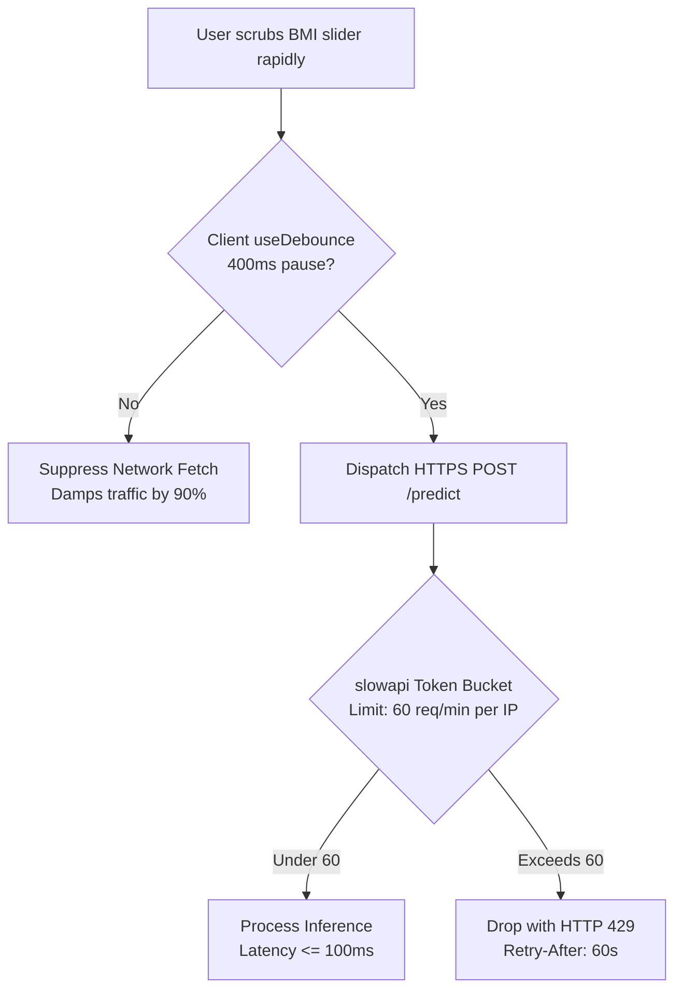

# Rate Limiting & Denial of Service (DoS) Defense: DeltaCare

**Document Version**: 1.0.0  
**Phase**: Pre-Development Foundation Phase  
**Author**: Senior Application Security Architect  
**Status**: Authoritative Security Baseline  
**Approved References**: [ADR-002](../decisions/002-zero-dollar-hosting-strategy.md), [ADR-005](../decisions/005-in-memory-token-bucket-rate-limiting.md), [ADR-009](../decisions/009-client-side-debounce-damping.md)

---

## 1. Multi-Tier DoS Defense Strategy

DeltaCare protects its free-tier cloud resources through a **Two-Tier Rate Damping Strategy**:
1. **Tier 1 (Client-Side Damper)**: 400ms event debounce on interactive inputs.
2. **Tier 2 (Server-Side Gate)**: In-memory token bucket limiter (`slowapi`) enforcing a 60 req/min cap.



---

## 2. Server-Side Rate Limiter Configuration (`apps/api/src/core/limiter.py`)

```python
from slowapi import Limiter
from slowapi.util import get_remote_address

# In-memory token bucket keyed by client IP address
limiter = Limiter(
    key_func=get_remote_address,
    default_limits=["120/minute"],
    storage_uri="memory://"
)

# Route-specific decorator in apps/api/src/main.py
@app.post("/predict")
@limiter.limit("60/minute")
async def predict_quote(request: Request, payload: QuoteRequest):
    ...
```

---

## 3. Rate Limit Breach Response Standard

When a client IP exceeds 60 requests in a 60-second sliding window:
1. **HTTP Status**: `429 Too Many Requests`.
2. **Standard Headers**:
   ```http
   Retry-After: 60
   X-RateLimit-Limit: 60
   X-RateLimit-Remaining: 0
   X-RateLimit-Reset: 1700000060
   ```
3. **Structured Body**:
   ```json
   {
     "error": {
       "code": "RATE_LIMIT_EXCEEDED",
       "message": "Too many requests. Maximum 60 requests per minute allowed.",
       "retry_after_seconds": 60
     }
   }
   ```
4. **Client Recovery Notice**:
   - The React client intercepts HTTP 429 and shows: *"Calculation limit reached. Please wait a moment before recalculating."*

