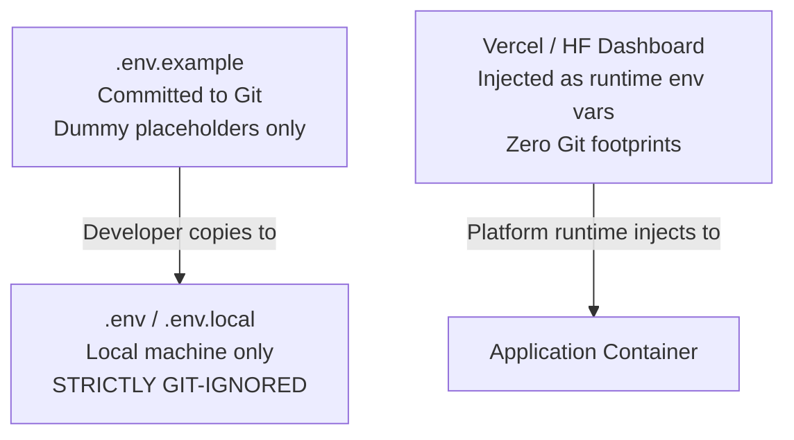

# Secret Management Policy: DeltaCare

**Document Version**: 1.0.0  
**Phase**: Pre-Development Foundation Phase  
**Author**: Senior Application Security Architect  
**Status**: Authoritative Security Baseline  

---

## 1. Zero Secrets Invariant

DeltaCare Phase 1 enforces an architectural **Zero Secrets Invariant**:
- The Phase 1 MVP **requires NO runtime API keys, database passwords, or cloud credentials**.
- The backend API runs public inference using an embedded, local `model.joblib` file.
- The frontend fetches the public API endpoint URL configured via public environment variables.

---

## 2. Environment Variables & Secret Hygiene

---

## 3. Mandatory Secret Protection Rules

1. **Never Commit Secrets**:
   - Committing credentials, private keys (`*.pem`), AWS tokens, or production URLs with embedded passwords to Git is a **PROTECTED** violation.
2. **Git Safeguards**:
   - The root `.gitignore` explicitly blocks `.env`, `.env.local`, `.env.*.local`, and `*.pem`.
   - GitHub secret scanning and push protection must be activated on the repository to reject commits containing token signatures.
3. **Template Documentation (`.env.example`)**:
   - Every environment variable used by the application must be documented in `apps/api/.env.example` and `apps/web/.env.example` with non-sensitive placeholder values.
4. **Leak Remediation Protocol**:
   - If an API token or credential is ever accidentally committed to Git:
     1. Invalidate and rotate the credential immediately at the provider dashboard.
     2. Rewrite Git history using `git-filter-repo` or BFG Repo-Cleaner to purge the commit.
     3. Never assume a revoked key in Git history is safe; treat it as compromised.

