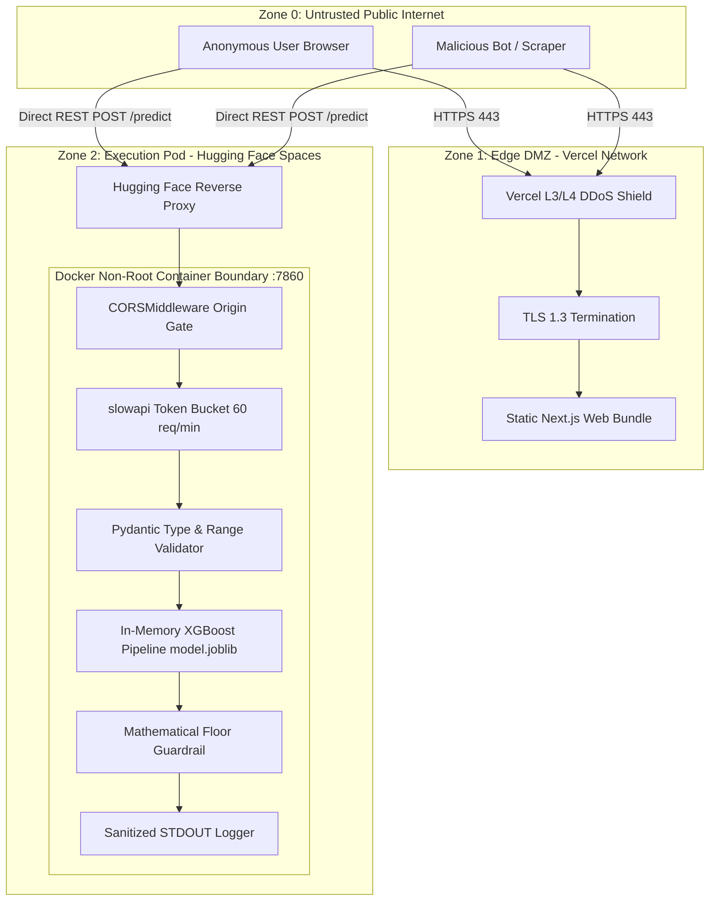

# Security Architecture & Trust Boundaries: DeltaCare

**Document Version**: 1.0.0  
**Phase**: Pre-Development Foundation Phase  
**Author**: Senior Application Security Architect  
**Status**: Authoritative Security Baseline  
**Approved References**: [ADR-002](../decisions/002-zero-dollar-hosting-strategy.md), [ADR-004](../decisions/004-stateless-b2c-mvp.md)

---

## 1. Security Architecture Diagram & Trust Boundaries

DeltaCare partitions the system into three distinct Trust Zones separated by hardened security boundaries:

---

## 2. Trust Boundary Definitions

### Trust Boundary 1: Public Internet $\rightarrow$ Edge Network (Zone 0 to Zone 1)
- **Protocol**: HTTPS over TLS 1.3 (TCP 443).
- **Controls**: Anycast routing, automated certificate rotation, volumetric Layer 3/4 DDoS absorption.
- **Threats**: Distributed Denial of Service (DDoS), DNS spoofing, man-in-the-middle (MitM).

### Trust Boundary 2: Web Client $\rightarrow$ API Gateway (Zone 0 to Zone 2)
- **Protocol**: REST over HTTPS / JSON.
- **Controls**:
  - `Access-Control-Allow-Origin: https://deltacare.vercel.app` (Blocks unauthorized browser contexts).
  - In-memory rate limiting via `slowapi` (Max 60 req/min per IP).
  - Pydantic schema validation (Drops malformed payloads with HTTP 422).
- **Threats**: Scraper flood attacks, adversarial payload injections, cross-site request forgery.

### Trust Boundary 3: API Gateway $\rightarrow$ In-Memory Engine (Zone 2 Internal)
- **Protocol**: Local process function execution.
- **Controls**:
  - Non-root user execution inside Docker (`USER appuser`).
  - Read-only serialized pipeline artifact (`model.joblib`).
  - Mathematical clamping floor preventing negative estimates.
- **Threats**: Deserialization exploits (RCE), out-of-memory container crashes.

---

## 3. Defense-in-Depth Layering

| Defense Layer | Mechanism | Implementation | Failure Mode |
| :--- | :--- | :--- | :--- |
| **Layer 1: Network** | Anycast + TLS 1.3 | Vercel Edge / HF Proxy | Connection dropped |
| **Layer 2: Origin** | CORS Whitelisting | FastAPI `CORSMiddleware` | HTTP 403 Forbidden |
| **Layer 3: Rate** | Token Bucket Throttling | `slowapi` in-memory | HTTP 429 Too Many Requests |
| **Layer 4: Schema** | Strict Bounds & Enums | Pydantic `BaseModel` | HTTP 422 Unprocessable Entity |
| **Layer 5: Business**| Value Clamping Floor | `apply_prediction_guardrail()` | Clamps to min $1,000.00 |
| **Layer 6: Logging**| Sanitized STDOUT | Structured JSON Logger | Raw payload omitted |

