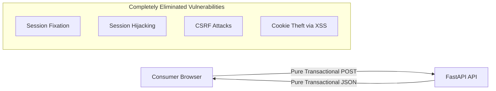

# Session Security Policy: DeltaCare

**Document Version**: 1.0.0  
**Phase**: Pre-Development Foundation Phase  
**Author**: Senior Application Security Architect  
**Status**: Authoritative Security Baseline  
**Approved References**: [ADR-004](../decisions/004-stateless-b2c-mvp.md)

---

## 1. Phase 1 Policy: Zero Session Storage (Stateless Invariant)

In Phase 1 (MVP), **DeltaCare maintains ZERO SESSION STATE**.

### 1.1 Inherent Security Advantages of Statelessness
- **Zero Cookies**: The application sets **no HTTP cookies** (`Set-Cookie`).
- **CSRF Immunity**: Cross-Site Request Forgery (CSRF) requires authenticated sessions stored in browser cookies to be exploited. Because DeltaCare has zero session cookies and relies on JSON payloads with `Content-Type: application/json` (which trigger browser CORS preflight checks), CSRF is **natively mitigated**.
- **No In-Memory Session Disks**: Container restarts do not log out users or orphan active sessions.

---

## 2. Phase 2 Standards: Planned Session Security (B2B Expansion)

When Phase 2 introduces persistent broker accounts:

1. **Short-Lived Access Tokens**: JWTs with a maximum TTL of **15 minutes**.
2. **Secure Cookie Attributes**: If refresh tokens are stored in browser cookies, they must enforce:
   - `HttpOnly`: Inaccessible to client-side JavaScript, preventing token theft via XSS.
   - `Secure`: Transmitted exclusively over encrypted HTTPS connections.
   - `SameSite=Strict`: Protects against cross-site request forgery.
3. **Session Revocation**: Real-time token blacklisting or JTI (JWT ID) revocation upon user logout or password reset.

