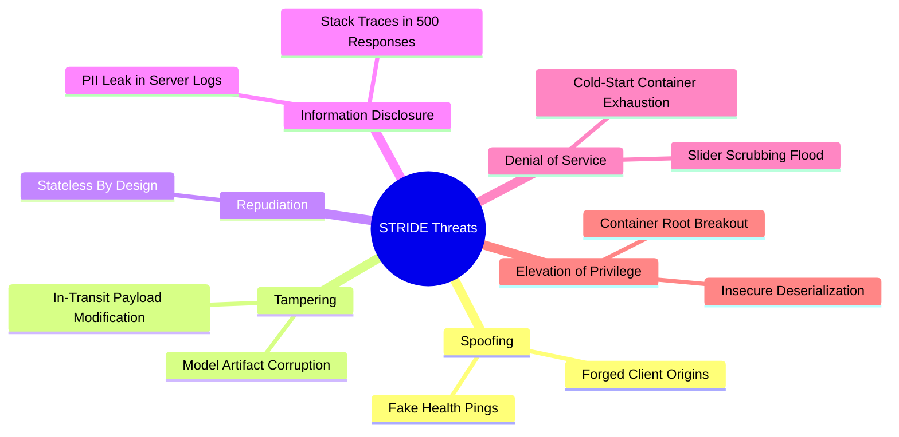

# Threat Model (STRIDE Methodology): DeltaCare

**Document Version**: 1.0.0  
**Phase**: Pre-Development Foundation Phase  
**Author**: Senior Application Security Architect  
**Status**: Authoritative Security Baseline  
**Methodology**: Microsoft STRIDE Threat Modeling Framework  

---

## 1. Asset Register & Security Objectives

| Asset ID | Asset Description | Security Objective | Criticality |
| :--- | :--- | :--- | :---: |
| **A-01** | Model Artifact (`model.joblib`) | Integrity (prevent tampering or poisoned weights) | High |
| **A-02** | Backend CPU / RAM Resources | Availability (prevent container starvation or OOM) | High |
| **A-03** | Prediction Service (`POST /predict`) | Availability & Correctness | High |
| **A-04** | Consumer Demographic Inputs | Confidentiality & Privacy (zero retention) | Critical |
| **A-05** | Production Domain Reputation | Integrity (prevent phishing or CORS abuse) | Medium |

---

## 2. STRIDE Threat Analysis Matrix

---

## 3. Detailed Threat Assessment & Mitigations

### 3.1 Spoofing (Identity Impersonation)
- **Threat T-01: Origin Header Forgery via Curl / Custom Scripts**
  - *Vector*: Attacker scripts `POST /predict` using tools that spoof or omit `Origin: https://deltacare.vercel.app`.
  - *Impact*: Bypasses browser CORS checks, consuming container CPU cycles.
  - *Mitigation*: CORS blocks browser contexts natively; Layer 7 rate limiting (`slowapi`: 60 req/min per IP) throttles non-browser scripts.
  - *Residual Risk*: Low. Public anonymous endpoint is intended for public consumption within rate limits.

### 3.2 Tampering (Data Modification)
- **Threat T-02: Adversarial Input Modification (Extreme/Negative Inputs)**
  - *Vector*: User submits negative age, float overflow BMI, or malicious strings in categorical fields.
  - *Impact*: Inversion of model weights, unexpected exception crashes, negative financial quotes.
  - *Mitigation*: Strict Pydantic validators reject out-of-bounds numbers ($18 \le \text{age} \le 100$, $10.0 \le \text{bmi} \le 60.0$) with HTTP 422. Mathematical floor guardrail clamps output to $\ge \$1,000.00$.
  - *Residual Risk*: Negligible.

- **Threat T-03: Model Artifact Poisoning (`model.joblib`)**
  - *Vector*: Attacker compromises local dev machine or CI pipeline to inject malicious serialized pickle payload.
  - *Impact*: Remote Code Execution (RCE) during `joblib.load()`.
  - *Mitigation*: `model.joblib` is generated strictly via automated headless repository scripts (`scripts/train_model.py`); validated by automated holdout tests (`scripts/audit_model.py`); tracked via Git LFS digests.
  - *Residual Risk*: Low. Mitigated by commit signing and branch protection rules.

### 3.3 Repudiation (Denial of Action)
- **Threat T-04: User Disputes Quote Accuracy**
  - *Vector*: User claims DeltaCare guaranteed an underwriting price that a real carrier refused.
  - *Impact*: Consumer complaints or legal disputes.
  - *Mitigation*: Prominently displayed statutory non-binder disclaimer rendered directly beneath the quote; statelessness means no binding contracts are executed.
  - *Residual Risk*: Negligible.

### 3.4 Information Disclosure (Data Leakage)
- **Threat T-05: Sensitive Health Data Leaked in Application Logs**
  - *Vector*: FastAPI routes log raw incoming `QuoteRequest` JSON bodies containing age, BMI, and smoker status.
  - *Impact*: Violation of user privacy; indirect retention of sensitive health metrics in cloud log viewers.
  - *Mitigation*: Custom structured logger (`apps/api/src/core/logger.py`) explicitly omits request bodies and logs only operational metadata (status code, latency, route).
  - *Residual Risk*: Zero.

- **Threat T-06: Internal Stack Trace Leakage in HTTP 500 Responses**
  - *Vector*: Unhandled Python exception exposes framework versions, internal file paths, or system environment.
  - *Impact*: Reconnaissance intelligence for attackers.
  - *Mitigation*: Global FastAPI exception handler intercepts all unhandled errors and returns a generic, sanitized JSON error contract.
  - *Residual Risk*: Low.

### 3.5 Denial of Service (DoS / Resource Starvation)
- **Threat T-07: Rapid Slider Dragging / Client Scrubbing Storm**
  - *Vector*: User violently scrubs the BMI slider, firing 50+ requests per second into the backend.
  - *Impact*: Triggers HTTP 429 rate limit errors, degrading UX and starving container CPU.
  - *Mitigation*: Client-side 400ms debounce hook (`useDebounce`) damps event dispatch by $85–90\%$, ensuring at most 1 request every 400ms.
  - *Residual Risk*: Low.

- **Threat T-08: Container Starvation via Automated Flooding**
  - *Vector*: Botnet floods Hugging Face Space with valid `POST /predict` calls from rotating IPs.
  - *Impact*: 2 vCPUs saturated; active users experience latency spikes.
  - *Mitigation*: `slowapi` drops traffic $> 60\text{ req/min}$ per IP at the ASGI middleware layer before invoking Pandas or XGBoost.
  - *Residual Risk*: Medium (Free-tier single-container reality).

### 3.6 Elevation of Privilege (Unauthorized Execution)
- **Threat T-09: Docker Container Escape / Root Compromise**
  - *Vector*: Attacker exploits a Linux kernel vulnerability in the container runtime to compromise the host.
  - *Impact*: Unauthorized host system access.
  - *Mitigation*: Dockerfile runs under an explicit non-root user (`USER appuser`) with read-only root filesystem permissions where possible.
  - *Residual Risk*: Low. Hugging Face Spaces isolates spaces in dedicated sandboxed pods.

