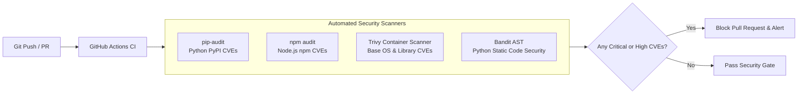

# Vulnerability Management & Supply Chain Security: DeltaCare

**Document Version**: 1.0.0  
**Phase**: Pre-Development Foundation Phase  
**Author**: Senior Application Security Architect  
**Status**: Authoritative Security Baseline  

---

## 1. Supply Chain Defense & Automated Scanning

Modern web applications inherit the majority of their vulnerabilities from third-party open-source libraries. DeltaCare enforces an automated supply-chain defense pipeline:

---

## 2. Vulnerability Remediation SLA Schedule

Identified Common Vulnerabilities and Exposures (CVEs) must be remediated according to strict Service Level Agreements (SLAs):

| CVSS v3.1 Severity Score | Categorization | Remediation Window (SLA) | Action Required |
| :--- | :--- | :---: | :--- |
| **9.0 – 10.0** | **Critical** | **Within 24 Hours** | Hotfix bump or temporary dependency removal. |
| **7.0 – 8.9** | **High** | **Within 7 Days** | Scheduled dependency upgrade in next PR. |
| **4.0 – 6.9** | **Medium** | **Within 30 Days** | Addressed during regular sprint maintenance. |
| **0.1 – 3.9** | **Low** | **Within 90 Days** | Evaluated on next major package version bump. |

---

## 3. Tooling Configuration & Policy Rules

1. **GitHub Dependabot**:
   - Configured via `.github/dependabot.yml` to run automated weekly dependency vulnerability audits across `apps/api/requirements.txt` and `apps/web/package.json`.
   - Automated security PRs are created automatically for known CVE patches.
2. **Minimal Docker Base Images**:
   - The API Docker container utilizes `python:3.10-slim` (Debian Slim) rather than full distributions, eliminating $> 300\text{MB}$ of unneeded OS packages, compilers, and debugging utilities from the container attack surface.
3. **Pinned Dependency Versions**:
   - All production packages in `requirements.txt` and `package.json` must be pinned to exact semantic versions (e.g., `fastapi==0.110.0`, `xgboost==2.0.3`) to prevent unverified upstream minor version compromises.

