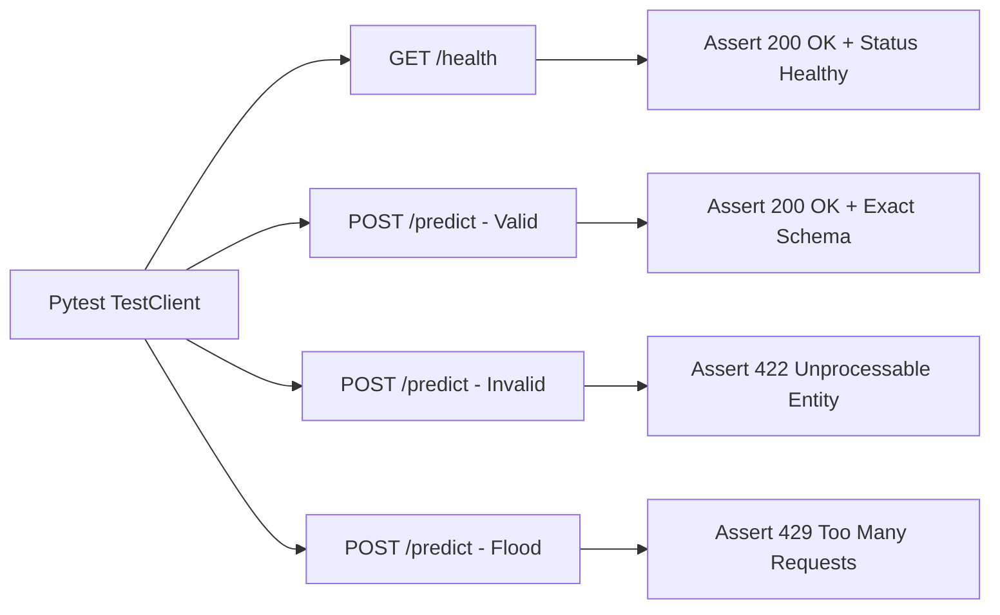

# API Testing & Contract Verification: DeltaCare

**Document Version**: 1.0.0  
**Phase**: Pre-Development Foundation Phase  
**Author**: Principal QA Architect  
**Status**: Authoritative Testing Baseline  

---

## 1. API Contract Verification

API testing guarantees that the FastAPI backend strictly adheres to its published OpenAPI contracts, status codes, and header behaviors.



---

## 2. API Test Case Specifications (`apps/api/tests/`)

### TC-API-01: Health Probe Response Verification
- **Route**: `GET /health`
- **Expected Status**: `200 OK`
- **Expected Body**: `{"status": "healthy", "version": "1.0.0"}`
- **Latency Requirement**: $< 10\text{ms}$ on warm container.

### TC-API-02: Strict Schema Validation & Error Reporting
- **Route**: `POST /predict`
- **Payload**:
  ```json
  { "age": 15, "bmi": -5.0 }
  ```
- **Expected Status**: `422 Unprocessable Entity`
- **Assertions**:
  - Response contains standard Pydantic error details.
  - Lists missing required fields (`sex`, `children`, `smoker`, `region`).
  - Identifies out-of-bounds fields (`age` must be $\ge 18$, `bmi` must be $\ge 10.0$).

### TC-API-03: Abuse Throttling (Rate Limiting)
- **Route**: `POST /predict`
- **Action**: Dispatch 61 valid requests from a single mock IP (`192.0.2.1`) within a 60-second window.
- **Assertions**:
  - Requests 1 through 60 return status `200 OK`.
  - Request 61 returns status `429 Too Many Requests`.
  - Response includes `Retry-After: 60` header.

### TC-API-04: CORS Origin Security Rejection
- **Route**: `POST /predict`
- **Action**: Submit request with header `Origin: https://malicious-phishing-site.com`.
- **Assertions**:
  - CORS middleware terminates connection or omits `Access-Control-Allow-Origin`.

