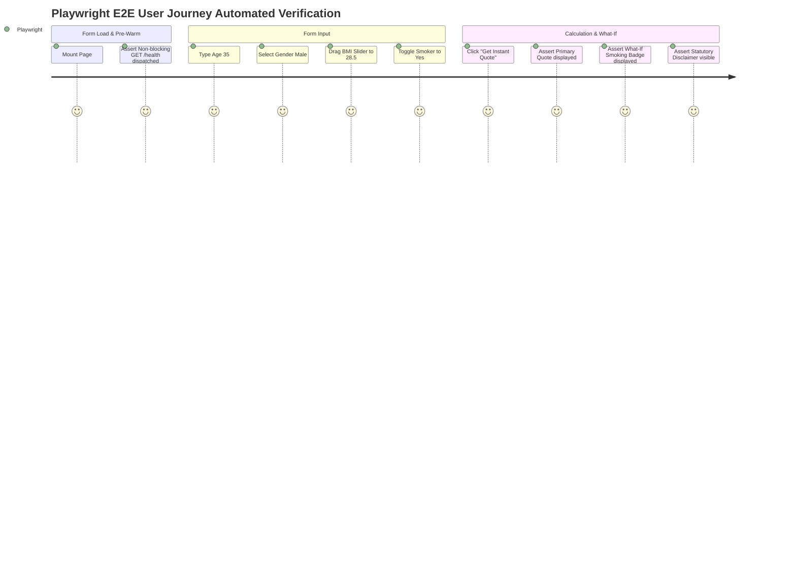

# End-to-End (E2E) Testing: DeltaCare

**Document Version**: 1.0.0  
**Phase**: Pre-Development Foundation Phase  
**Author**: Principal QA Architect  
**Status**: Authoritative Testing Baseline  

---

## 1. E2E Testing Framework

End-to-End testing simulates real human user interactions in an automated browser instance (Chromium, Firefox, WebKit) using **Playwright**.

---

## 2. Playwright E2E Test Scenarios

### TC-E2E-01: Full Quoting Journey with What-If Savings Badge
1. **Navigate**: Open root URL (`http://localhost:3000`).
2. **Pre-Warm Assertion**: Verify background `GET /health` was fired without rendering visible spinners.
3. **Fill Form**:
   - Fill Age input with `45`.
   - Select Sex `female`.
   - Adjust BMI slider to `31.2`.
   - Select Dependents `2`.
   - Toggle Smoker switch to `yes`.
   - Select Region `southeast`.
4. **Submit**: Click **"Get Instant Quote"**.
5. **Assertions**:
   - Button disables and shows inline spinner.
   - Quote result card animates into view.
   - Monthly hero price is clearly rendered in large typography (e.g., `$850.00 / mo`).
   - Annual price is displayed as subtitle (`$10,200.00 / yr`).
   - Confidence interval range is visible (`$720.00 – $980.00 / mo`).
   - Dynamic What-If badge renders: *"Quitting smoking could save you ~$3,200 / year"*.
   - Statutory non-binder disclaimer is visible directly below the card.

### TC-E2E-02: Interactive BMI Slider Scrubbing & Debounce
1. **Navigate**: Open root URL.
2. **Action**: Drag the BMI slider continuously from `22.0` to `35.0` over 3 seconds.
3. **Network Interception**:
   - Assert network requests are damped: exactly 1 request sent per 400ms pause.
   - The UI does not freeze or throw rate limit alerts during scrubbing.
   - Price updates dynamically as scrubbing pauses.

