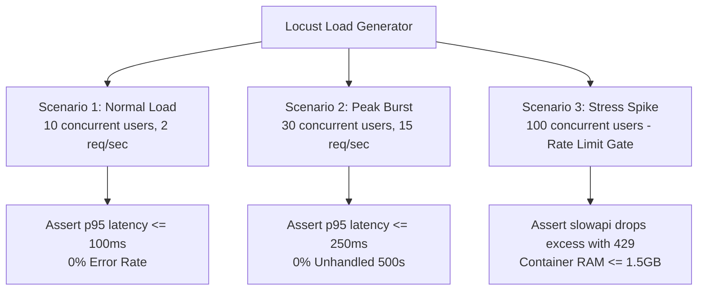

# Load Testing & Capacity Analysis: DeltaCare

**Document Version**: 1.0.0  
**Phase**: Pre-Development Foundation Phase  
**Author**: Principal QA Architect  
**Status**: Authoritative Testing Baseline  

---

## 1. Load Testing Objectives

Load testing evaluates the behavior of the FastAPI application under simulated multi-user traffic, validating that the container sustains peak concurrent usage without process crashes or connection timeouts.

---

## 2. Load Testing Scenarios (Locust Specification)

### TC-LOAD-01: Baseline User Load
- **Virtual Users**: 10 concurrent simulated consumers.
- **Duration**: 5 minutes continuous.
- **Pacing**: 1 request every 5 seconds per user (simulating normal form completion).
- **Success Criteria**:
  - $p95$ response time $\le 100\text{ms}$.
  - $p99$ response time $\le 200\text{ms}$.
  - HTTP error rate: `0.0%`.

### TC-LOAD-02: Peak Interactive Scrubbing Burst
- **Virtual Users**: 25 concurrent users scrubbing the BMI slider.
- **Pacing**: 1 request every 400ms per user (mimicking debounced slider events).
- **Target Throughput**: $\approx 60\text{ requests/second}$ total load.
- **Success Criteria**:
  - Zero unhandled HTTP 500 errors.
  - Container CPU remains below 85%.
  - Zero OOM container restarts.

