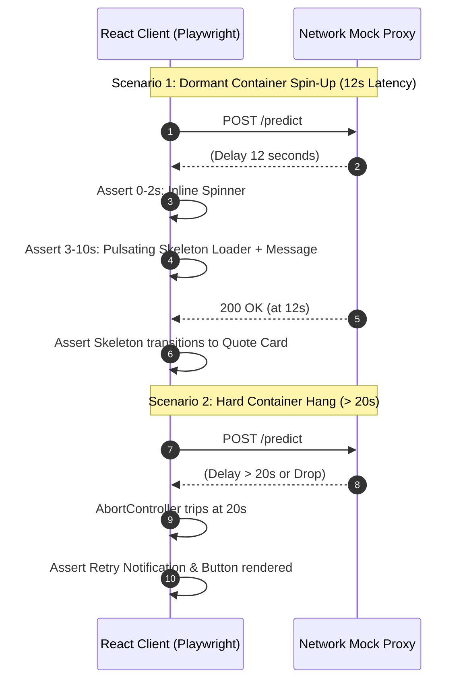

# Recovery & Fault Tolerance Testing: DeltaCare

**Document Version**: 1.0.0  
**Phase**: Pre-Development Foundation Phase  
**Author**: Principal QA Architect  
**Status**: Authoritative Testing Baseline  

---

## 1. Fault Injection & Recovery Scenarios

Recovery testing evaluates DeltaCare's resilience during infrastructure cold starts, network latency spikes, and backend connection hangs.

---

## 2. Recovery Test Specifications

### TC-REC-01: Staged Cold-Start Transition Verification
- **Setup**: Playwright intercepts `POST /predict` and introduces an artificial 12-second response delay.
- **Action**: User clicks "Get Instant Quote".
- **Assertions**:
  1. At $t = 1\text{s}$, verify submit button text is `"Calculating..."` with an active spinner.
  2. At $t = 4\text{s}$, verify `ColdStartSkeleton` is visible in the DOM with text: *"Waking up the pricing engine... (this takes a few seconds)"*.
  3. At $t = 12\text{s}$, mock resolves with HTTP 200; verify skeleton disappears and quote card renders without error.

### TC-REC-02: 20-Second Timeout Recovery
- **Setup**: Playwright intercepts `POST /predict` and stalls indefinitely.
- **Action**: User clicks "Get Instant Quote".
- **Assertions**:
  1. At $t = 20\text{s}$, client-side `AbortController` aborts the pending fetch request.
  2. The UI renders an actionable alert card: *"Our servers are warming up. Please click calculate again."*
  3. A visible **"Retry"** button is present.
  4. Clicking "Retry" dispatches a fresh network request.

