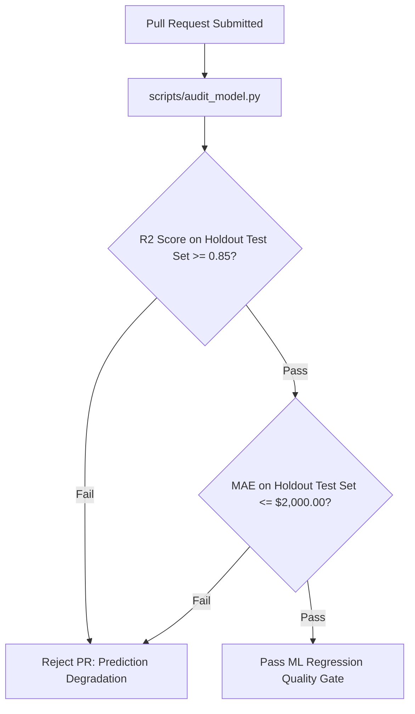

# Regression Testing & Quality Gates: DeltaCare

**Document Version**: 1.0.0  
**Phase**: Pre-Development Foundation Phase  
**Author**: Principal QA Architect  
**Status**: Authoritative Testing Baseline  
**Approved References**: [ADR-003](../decisions/003-unified-sklearn-pipeline.md), [ADR-006](../decisions/006-tree-ensemble-xgboost-regression.md)

---

## 1. Automated Machine Learning Regression Gate

Unlike traditional web applications where regression testing covers only software logic, DeltaCare must also guard against **Actuarial Prediction Drift** and **Statistical Degradation**.

Before any code change or retrained `model.joblib` artifact is merged into `main`, GitHub Actions executes `scripts/audit_model.py`:



---

## 2. Regression Gate Implementation (`scripts/audit_model.py`)

```python
import sys
import joblib
import pandas as pd
from sklearn.metrics import r2_score, mean_absolute_error

BENCHMARK_R2_THRESHOLD = 0.85
BENCHMARK_MAE_THRESHOLD = 2000.00  # Equivalent to $166.67/mo

def audit_regression_quality(model_path: str, test_data_path: str):
    pipeline = joblib.load(model_path)
    test_df = pd.read_csv(test_data_path)
    
    X_test = test_df.drop(columns=["charges"])
    y_test = test_df["charges"]
    
    y_pred = pipeline.predict(X_test)
    
    calculated_r2 = r2_score(y_test, y_pred)
    calculated_mae = mean_absolute_error(y_test, y_pred)
    
    print(f"Audit Metrics: R2 = {calculated_r2:.4f}, MAE = ${calculated_mae:.2f}")
    
    if calculated_r2 < BENCHMARK_R2_THRESHOLD:
        print(f"FAILED: R2 {calculated_r2:.4f} is below threshold {BENCHMARK_R2_THRESHOLD}")
        sys.exit(1)
        
    if calculated_mae > BENCHMARK_MAE_THRESHOLD:
        print(f"FAILED: MAE ${calculated_mae:.2f} exceeds threshold ${BENCHMARK_MAE_THRESHOLD}")
        sys.exit(1)
        
    print("SUCCESS: Model satisfies all actuarial regression quality gates.")
    sys.exit(0)
```

---

## 3. Software Logic Regression Suite

Alongside the statistical audit, the standard software regression suite executes on every commit:
- 100% of API contract tests (`apps/api/tests/`).
- 100% of frontend component tests (`apps/web/tests/`).
- Strict linter checks (`ruff check .`, `mypy --strict .`, `tsc --noEmit`).

