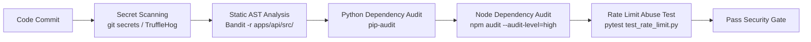

# Security Testing & Vulnerability Scanning: DeltaCare

**Document Version**: 1.0.0  
**Phase**: Pre-Development Foundation Phase  
**Author**: Principal QA Architect & Application Security Engineer  
**Status**: Authoritative Testing Baseline  

---

## 1. Automated Security Testing Pipeline

DeltaCare embeds automated security tests into its local pre-commit hooks and GitHub Actions CI pipelines:

---

## 2. Security Test Cases & Tools

| Test Case ID | Test Category | Objective | Verification Command | Gate Threshold |
| :--- | :--- | :--- | :--- | :--- |
| **TC-SEC-01** | Secret Scanning | Verify no credentials or private keys are committed | `trufflehog git file://. --since-commit HEAD~1` | 0 findings |
| **TC-SEC-02** | Python AST Security | Audit Python code for insecure imports, `eval()`, or SQL | `bandit -r apps/api/src/` | 0 High / Medium issues |
| **TC-SEC-03** | Python Dependencies | Scan `requirements.txt` for known PyPI CVEs | `pip-audit -r apps/api/requirements.txt` | 0 High / Critical CVEs |
| **TC-SEC-04** | Node Dependencies | Scan `package.json` for known npm CVEs | `npm audit --audit-level=high` | 0 High / Critical CVEs |
| **TC-SEC-05** | CORS Origin Security | Verify requests from unauthorized origins are rejected | `pytest apps/api/tests/test_cors.py` | 100% passing |
| **TC-SEC-06** | Rate Limit Throttling | Verify 61st request returns HTTP 429 | `pytest apps/api/tests/test_rate_limit.py` | 100% passing |
| **TC-SEC-07** | Non-Root Docker Audit | Verify Docker container executes as non-root user | `docker run --rm deltacare-api whoami` | Returns `appuser` (UID 1000) |
| **TC-SEC-08** | Zero PII in Logs | Verify request payloads are omitted from structured logs | Automated log inspection test | Zero PII features logged |

---

## 3. Policy on Security Test Failures
- Under **no circumstances** may a security check or vulnerability scan be commented out or suppressed to unblock a deployment.
- If a dependency exhibits a critical vulnerability, it must be updated or replaced within the SLAs specified in [`docs/security/VULNERABILITY_MANAGEMENT.md`](../security/VULNERABILITY_MANAGEMENT.md).

