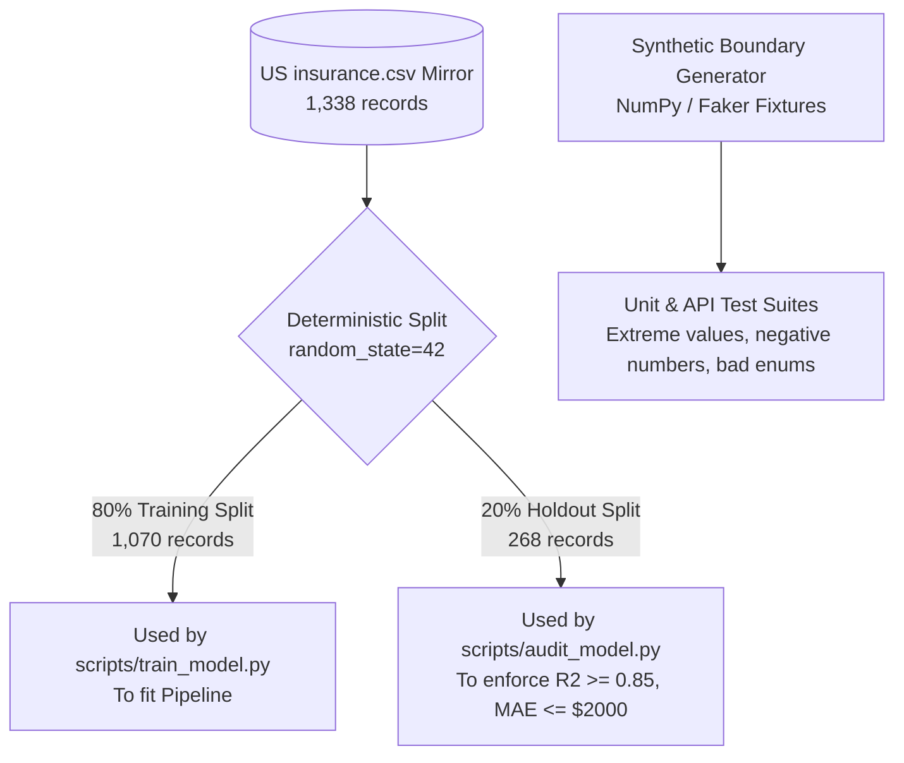

# Test Data Management: DeltaCare

**Document Version**: 1.0.0  
**Phase**: Pre-Development Foundation Phase  
**Author**: Principal QA Architect & Data Engineer  
**Status**: Authoritative Testing Baseline  

---

## 1. Test Data Strategy & Partitioning

DeltaCare relies on two distinct classes of test data:
1. **The Official Holdout Split (`X_test`, `y_test`)**: A deterministic 20% random partition (fixed random seed `42`) of the 1,338 US `insurance.csv` records reserved exclusively for model benchmark auditing.
2. **Synthetic Boundary Fixtures**: Programmatically generated single-row payloads used in unit and API test suites.



---

## 2. Standardized Test Fixtures (`apps/api/tests/conftest.py`)

### 2.1 Standard Nominal Beneficiary Fixture
```python
@pytest.fixture
def nominal_payload():
    return {
        "age": 35,
        "sex": "male",
        "bmi": 24.5,
        "children": 1,
        "smoker": "no",
        "region": "northwest"
    }
```

### 2.2 High-Risk Extreme Beneficiary Fixture (High Interaction Split)
```python
@pytest.fixture
def high_risk_payload():
    return {
        "age": 60,
        "sex": "male",
        "bmi": 38.5,  # Obese
        "children": 3,
        "smoker": "yes",  # Smoker x High BMI surge
        "region": "southeast"
    }
```

### 2.3 Boundary Edge Fixtures
- **Minimum Valid**: `{"age": 18, "sex": "female", "bmi": 10.0, "children": 0, "smoker": "no", "region": "northeast"}`
- **Maximum Valid**: `{"age": 100, "sex": "male", "bmi": 60.0, "children": 10, "smoker": "yes", "region": "southwest"}`

---

## 3. Test Data Privacy & Isolation Invariant
- **Zero Real Patient Data**: Real health records, clinical patient identities, or identifiable medical claims must **never** be imported into test suites.
- All testing operates strictly on the anonymized public benchmark dataset and synthetic fixtures.

