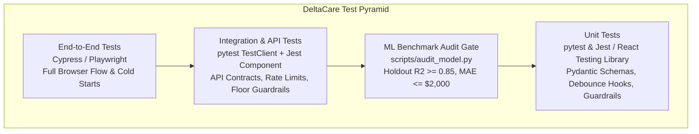
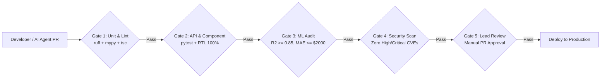

# Master Testing Strategy: DeltaCare

**Document Version**: 1.0.0  
**Phase**: Pre-Development Foundation Phase  
**Author**: Principal QA Architect & Software Test Engineer  
**Status**: Authoritative Testing Baseline  
**Approved References**: [ADR-003](../decisions/003-unified-sklearn-pipeline.md), [ADR-005](../decisions/005-in-memory-token-bucket-rate-limiting.md), [ADR-006](../decisions/006-tree-ensemble-xgboost-regression.md)

---

## 1. Quality Engineering Philosophy

Testing in DeltaCare is an **automated, multi-tiered verification gate system**. We reject the premise that software is complete merely because it compiles or runs on a developer's machine.

Our testing strategy is engineered around four core tenets:
1. **Actuarial Machine Learning Rigor**: Regression models are validated against strict statistical holdout gates ($R^2 \ge 0.85$, $\text{MAE} \le \$2,000$).
2. **Boundary & Negative Testing Over Happy-Path Bias**: Over 60% of test scenarios target edge-case inputs, malformed types, rate breaches, and container cold starts.
3. **Zero Assertions Weakening**: Tests must never be deleted, skipped, or had assertions loosened to bypass CI failures.
4. **Automated CI/CD Quality Gates**: No pull request can merge into `main` without passing 100% of automated unit, API, security, and benchmark tests.

---

## 2. Test Pyramid & Execution Spectrum

---

## 3. Master Testing Documentation Registry

All test specifications and QA governance documents reside in `docs/testing/`:

| Document | Primary Focus | Tooling / Framework |
| :--- | :--- | :--- |
| [TEST_PLAN.md](TEST_PLAN.md) | High-level master test plan, scheduling, and risk matrix | QA Governance |
| [UNIT_TESTING.md](UNIT_TESTING.md) | Granular unit tests for backend math, schemas, and React hooks | `pytest`, Jest / Vitest |
| [INTEGRATION_TESTING.md](INTEGRATION_TESTING.md)| Cross-module testing (FastAPI + in-memory ML pipeline) | `pytest` + `TestClient` |
| [API_TESTING.md](API_TESTING.md) | Contract testing for `GET /health` and `POST /predict` | HTTPX / Pytest |
| [E2E_TESTING.md](E2E_TESTING.md) | End-to-end browser journeys, What-If badges, slider debounce | Playwright |
| [SECURITY_TESTING.md](SECURITY_TESTING.md) | Static AST security linting, dependency audits, secret scans | Bandit, pip-audit, npm audit |
| [PERFORMANCE_TESTING.md](PERFORMANCE_TESTING.md)| Active inference latency ($\le 100\text{ms}$) and memory profiling | pytest-benchmark, memory-profiler |
| [LOAD_TESTING.md](LOAD_TESTING.md) | Concurrency testing under synthetic load (10–50 req/sec) | Locust / k6 |
| [RECOVERY_TESTING.md](RECOVERY_TESTING.md) | Cold-start timeout resilience (0–2s, 3–10s, 20s abort) | Playwright Network Mocking |
| [REGRESSION_TESTING.md](REGRESSION_TESTING.md)| Automated holdout baseline regression suites | CI GitHub Actions |
| [ACCEPTANCE_TESTING.md](ACCEPTANCE_TESTING.md)| Gherkin scenario validation mapped to business requirements | Behave / Cucumber |
| [TEST_DATA_MANAGEMENT.md](TEST_DATA_MANAGEMENT.md)| Deterministic synthetic datasets and holdout partitioning | Faker, NumPy |
| [BUG_REPORTING.md](BUG_REPORTING.md) | Standardized bug defect triage, lifecycles, and templates | GitHub Issues Standard |

---

## 4. Quality Gates for Release Readiness

