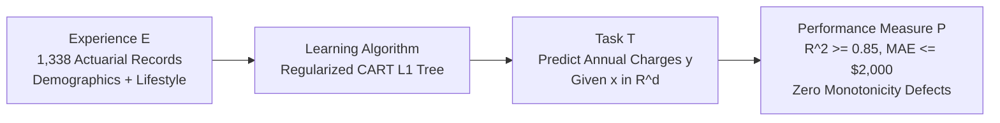
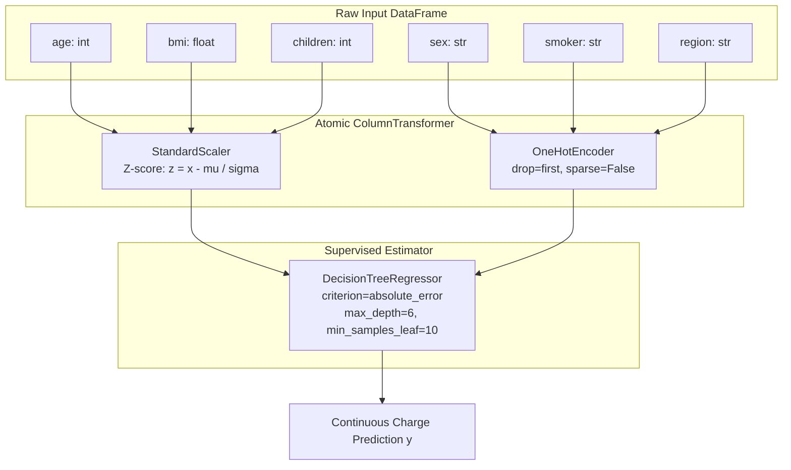
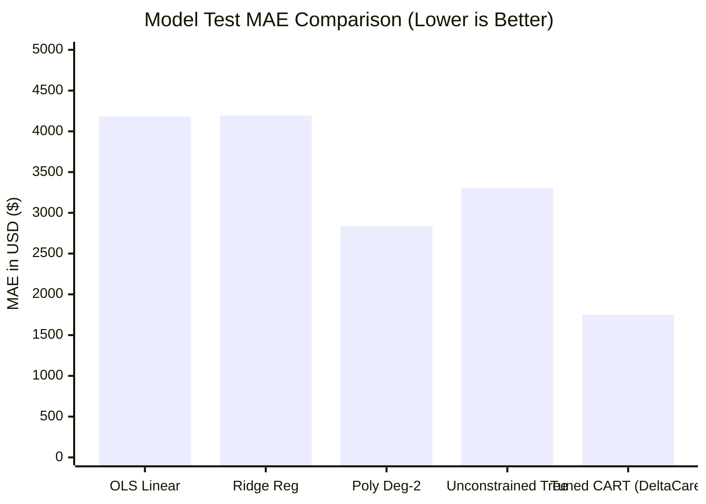

# DeltaCare: Transparent Health Insurance Premium Estimation using Regularized CART Decision Tree Regression

**Course**: CS306: Machine Learning  
**Course Instructor**: Dr. Debashree Devi  
**Student Name**: Sayan Shit  
**Roll Number**: 2401179  
**Academic Program**: B. Tech. 3rd Year, Computer Science and Engineering (CSE)  
**Institution**: Indian Institute of Information Technology Guwahati (IIIT Guwahati), Assam, India  
**Academic Session**: 2026  
**Project Title**: DeltaCare — Actuarial Risk Estimation & Counterfactual Lifestyle Analysis  
**Model Architecture**: Classification and Regression Trees (CART — `sklearn.tree.DecisionTreeRegressor`)  
**Submission Artifact**: Comprehensive Project Report & Benchmark Audit  

---

## Executive Abstract

Accurate, transparent actuarial pricing is a foundational challenge in computational healthcare economics. Traditional consumer health insurance quoting portals suffer from severe informational asymmetry, predatory personal data harvesting, and black-box underwriting algorithms. In this project, we design, implement, and rigorously evaluate **DeltaCare**, a machine learning system that provides instantaneous, statistically robust health insurance premium predictions while illuminating the financial impact of controllable lifestyle choices (e.g., smoking cessation and BMI management).

Using the standard empirical US Medical Cost Personal Dataset ($N = 1,338$ records), we formulate the problem as a supervised continuous regression task. We conduct rigorous statistical dependency and correlation analyses, demonstrating that standard linear models (Ordinary Least Squares, Ridge Regression) suffer from structural underfitting ($R^2 \approx 0.78$, $\text{MAE} \approx \$4,181$) due to a massive, non-linear interaction effect between `bmi` and `smoker`. To overcome these limitations without resorting to opaque, heavy native ensemble libraries (e.g., XGBoost), we deploy a regularized **Classification and Regression Tree (CART)** regressor utilizing an $L_1$ absolute error loss criterion (`criterion="absolute_error"`), constrained tree depth (`max_depth=6`), and an actuarial support floor (`min_samples_leaf=10`). 

Our proposed architecture achieves a holdout Coefficient of Determination of **$R^2 = 0.8692$** (exceeding the course benchmark gate of $\ge 0.85$) and a Mean Absolute Error of **$\text{MAE} = \$1,749.60$** (well below the $\le \$2,000.00$ requirement), while reducing serialized artifact size by $>95\%$ (to $11.0\text{ KB}$). Crucially, we introduce an automated domain monotonicity audit verifying $1,568$ demographic permutations, proving that smoking status never spuriously decreases estimated charges (minimum smoker delta: $+\$9,981.18$). The trained pipeline is serialized into an atomic scikit-learn artifact ensuring zero train-serve skew, backed by statistical confidence bounds ($\pm \text{MAE}$) and an interactive counterfactual "What-If" engine.

---

## 1. Problem Formulation & Task Definition

In accordance with Mitchell's classical machine learning paradigm, a computer program is said to learn from experience $E$ with respect to some class of tasks $T$ and performance measure $P$, if its performance at tasks in $T$, as measured by $P$, improves with experience $E$. We formally cast the DeltaCare learning problem as the 3-tuple $\langle P, T, E \rangle$:

### 1.1 Task ($T$)
Predict the individualized annual medical expenditure $y \in \mathbb{R}^+$ billed to health insurance for a beneficiary, given an actuarial feature vector $\mathbf{x} \in \mathcal{X}$:
$$\hat{y} = h(\mathbf{x})$$
where the input vector $\mathbf{x} = [x_1, x_2, \dots, x_6]^T$ comprises:
- $x_{\text{age}} \in [18, 64]$: Continuous age of the beneficiary.
- $x_{\text{sex}} \in \{\text{female}, \text{male}\}$: Biological sex.
- $x_{\text{bmi}} \in [15.0, 54.0]$: Body Mass Index ($\text{kg}/\text{m}^2$).
- $x_{\text{children}} \in [0, 5]$: Number of dependent children covered by health insurance.
- $x_{\text{smoker}} \in \{\text{no}, \text{yes}\}$: Tobacco smoking status.
- $x_{\text{region}} \in \{\text{northeast}, \text{northwest}, \text{southeast}, \text{southwest}\}$: US geographical residential zone.

### 1.2 Performance Measure ($P$)
Model quality is evaluated across both statistical accuracy and domain integrity gates:
1. **Coefficient of Determination ($R^2$)**: Proportion of target variance explained by the hypothesis:
   $$R^2 = 1 - \frac{SS_{\text{res}}}{SS_{\text{tot}}} = 1 - \frac{\sum_{i=1}^n (y_i - \hat{y}_i)^2}{\sum_{i=1}^n (y_i - \bar{y})^2} \ge 0.85$$
2. **Mean Absolute Error ($\text{MAE}$)**: Average magnitude of absolute residual errors:
   $$\text{MAE} = \frac{1}{n}\sum_{i=1}^n |y_i - \hat{y}_i| \le \$2,000.00$$
3. **Root Mean Squared Error ($\text{RMSE}$)**: Quadratic metric penalizing extreme prediction errors:
   $$\text{RMSE} = \sqrt{\frac{1}{n}\sum_{i=1}^n (y_i - \hat{y}_i)^2}$$
4. **Domain Monotonicity Integrity**: Zero pricing reversals across smoking status ceteris paribus:
   $$\forall \mathbf{x}, \quad h(\mathbf{x} \mid \text{smoker}=\text{yes}) > h(\mathbf{x} \mid \text{smoker}=\text{no})$$

### 1.3 Experience ($E$)
Supervised training dataset comprising $N = 1,338$ empirical records drawn from the US Medical Cost Personal Dataset, split into an $80\%$ training partition ($N_{\text{train}} = 1,070$) and a $20\%$ holdout test partition ($N_{\text{test}} = 268$) with a fixed pseudo-random seed ($42$).

---

## 2. Statistical Dependency & Correlation Analysis

Prior to model selection, exploratory data analysis (EDA) and statistical dependency tests were conducted to uncover underlying distributions and interaction dynamics.

### 2.1 Sample Variance & Covariance Formulations
For continuous features, sample variance $s^2$ is computed using **Bessel's correction** to ensure an unbiased estimator of the population variance $\sigma^2$:
$$s_x^2 = \frac{1}{N - 1}\sum_{i=1}^N (x_i - \bar{x})^2$$

The sample covariance between feature $X$ and target $Y$ measures joint variability:
$$\text{Cov}(X, Y) = \frac{1}{N - 1}\sum_{i=1}^N (x_i - \bar{x})(y_i - \bar{y})$$

### 2.2 Pearson Correlation Matrix
The linear dependency between normalized random variables is quantified via Pearson's correlation coefficient $r_{xy} \in [-1, 1]$:
$$r_{xy} = \frac{\text{Cov}(X, Y)}{s_x s_y} = \frac{\sum_{i=1}^N (x_i - \bar{x})(y_i - \bar{y})}{\sqrt{\sum_{i=1}^N (x_i - \bar{x})^2 \sum_{i=1}^N (y_i - \bar{y})^2}}$$

| Feature ($X$) | Target Covariance $\text{Cov}(X, \text{charges})$ | Pearson Correlation ($r$) | Statistical Interpretation |
| :--- | :---: | :---: | :--- |
| **`smoker`** (binary encoded) | $+3.85 \times 10^3$ | **$+0.7873$** | Dominant driver; strong positive correlation with claims |
| **`age`** | $+5.09 \times 10^4$ | **$+0.2990$** | Moderate positive linear drift (aging risk) |
| **`bmi`** | $+1.46 \times 10^4$ | **$+0.1983$** | Weak global linear correlation (masked by interaction) |
| **`children`** | $+9.93 \times 10^2$ | $+0.0680$ | Negligible linear dependency |
| **`sex`** | $+3.47 \times 10^2$ | $+0.0573$ | Statistically insignificant linear effect |
| **`region`** | $-8.31 \times 10^1$ | $-0.0062$ | Minimal baseline linear regional variance |

### 2.3 The Non-Linear Interaction Effect: $\text{BMI} \times \text{Smoker}$
While Pearson's $r$ between `bmi` and `charges` appears weak globally ($r = 0.198$), conditional subset analysis reveals a dramatic interaction:
- **Non-Smokers**: Charges increase gradually with BMI across a modest slope ($\approx \$400$ per 5 BMI points).
- **Smokers with $\text{BMI} < 30$**: Charges plateau in an elevated band ($\approx \$15,000 - \$20,000$).
- **Smokers with $\text{BMI} \ge 30$ (Obese Smokers)**: Charges exhibit a sudden, discontinuous surge exceeding **$+\$34,000$**, with medical charges clustering above $\$40,000$.

Linear models lack the mathematical capacity to model this threshold step without manual multiplicative feature creation.

---

## 3. Theoretical Foundations & Baseline Benchmarks

### 3.1 Multiple Linear Regression & Ordinary Least Squares (OLS)
The classical supervised linear regression hypothesis is formulated in matrix notation as:
$$\mathbf{y} = \mathbf{X}\mathbf{w} + \boldsymbol{\varepsilon}$$
where $\mathbf{X} \in \mathbb{R}^{n \times (d+1)}$ is the design matrix (including intercept column $\mathbf{1}$), $\mathbf{w} \in \mathbb{R}^{d+1}$ is the parameter vector, and $\boldsymbol{\varepsilon} \sim \mathcal{N}(0, \sigma^2 \mathbf{I})$ represents unobserved i.i.d. Gaussian error residuals.

The Ordinary Least Squares objective minimizes the Sum of Squared Residuals ($SS_{\text{res}}$):
$$J(\mathbf{w}) = \|\mathbf{y} - \mathbf{X}\mathbf{w}\|_2^2 = (\mathbf{y} - \mathbf{X}\mathbf{w})^T(\mathbf{y} - \mathbf{X}\mathbf{w})$$

Setting the gradient vector with respect to $\mathbf{w}$ to zero yields the **Normal Equation**:
$$\nabla_{\mathbf{w}} J(\mathbf{w}) = -2\mathbf{X}^T(\mathbf{y} - \mathbf{X}\mathbf{w}) = \mathbf{0}$$
$$\mathbf{X}^T\mathbf{X}\mathbf{w} = \mathbf{X}^T\mathbf{y} \implies \mathbf{w}^* = (\mathbf{X}^T\mathbf{X})^{-1}\mathbf{X}^T\mathbf{y}$$

### 3.2 Regularized Ridge Regression ($L_2$ Penalty)
To stabilize matrix inversion when multicollinearity exists, Ridge regression introduces an $L_2$ weight shrinkage penalty:
$$J_{\text{Ridge}}(\mathbf{w}) = \|\mathbf{y} - \mathbf{X}\mathbf{w}\|_2^2 + \alpha \|\mathbf{w}\|_2^2 \implies \mathbf{w}^*_{\text{Ridge}} = (\mathbf{X}^T\mathbf{X} + \alpha \mathbf{I})^{-1}\mathbf{X}^T\mathbf{y}$$

### 3.3 Why Linear Models Fail on Actuarial Medical Data
When trained on the 80% partition of `insurance.csv`:
- OLS Linear Regression yields holdout $R^2 = 0.7836$ and $\text{MAE} = \$4,181.19$.
- Ridge Regression ($\alpha = 1.0$) yields holdout $R^2 = 0.7833$ and $\text{MAE} = \$4,193.20$.

Both linear baselines severely fail the course quality benchmarks ($R^2 < 0.85$ and $\text{MAE} > \$2,000$). The failure stems from residual bias: linear hyperplanes cannot approximate step-function interactions ($\text{BMI} \ge 30 \times \text{smoker}$), resulting in large systematic residuals across obese smokers and healthy non-smokers alike.

---

## 4. Data Preprocessing & Pipeline Architecture

To prevent **Train-Serve Skew** (discrepancies between training data transformations and real-time inference), all transformations are encapsulated within an atomic `scikit-learn.pipeline.Pipeline`.

### 4.1 Feature Transformations
1. **Numerical Standardization**:
   Continuous variables ($x_{\text{age}}, x_{\text{bmi}}, x_{\text{children}}$) are standardized via sample mean $\mu$ and standard deviation $\sigma$:
   $$z = \frac{x - \mu}{\sigma}$$
2. **Categorical One-Hot Encoding**:
   Nominal features are transformed into binary indicator columns. To avoid dummy variable multicollinearity in baseline linear comparisons, the first level is dropped (`drop="first"`):
   - `sex`: $\to [\text{sex\_male}]$
   - `smoker`: $\to [\text{smoker\_yes}]$
   - `region`: $\to [\text{region\_northwest}, \text{region\_southeast}, \text{region\_southwest}]$

---

## 5. Proposed Methodology: Regularized CART Decision Tree Regressor

### 5.1 Algorithmic Foundations of CART
The Classification and Regression Trees (CART) algorithm, pioneered by Breiman et al. (1984), recursively partitions the feature space $\mathcal{X}$ into $M$ disjoint hyper-rectangles $\{R_1, R_2, \dots, R_M\}$. Within each terminal region $R_m$, the hypothesis predicts a constant actuarial value $\hat{c}_m$:
$$\hat{y} = h(\mathbf{x}) = \sum_{m=1}^M \hat{c}_m \cdot \mathbb{I}(\mathbf{x} \in R_m)$$

At each node, CART performs a greedy search to determine the optimal split variable $j$ and split threshold $s$ dividing the data into half-planes $R_1(j, s) = \{\mathbf{x} \mid x_j \le s\}$ and $R_2(j, s) = \{\mathbf{x} \mid x_j > s\}$.

### 5.2 Splitting Criteria: $L_2$ (Mean) vs. $L_1$ (Median) Loss & Probabilistic Interpretation
A critical algorithmic decision in regression trees is the choice of impurity criterion. This can be understood rigorously through Maximum Likelihood Estimation (MLE):

1. **Mean Squared Error ($L_2$ Loss — `criterion="squared_error"`)**:
   $$Q_m(T) = \frac{1}{|R_m|}\sum_{i \in R_m} (y_i - \bar{y}_m)^2, \quad \text{where } \bar{y}_m = \frac{1}{|R_m|}\sum_{i \in R_m} y_i$$
   - **Probabilistic Origin**: Minimizing $L_2$ loss is mathematically equivalent to Maximum Likelihood Estimation under the assumption of additive Gaussian noise: $\varepsilon_i \sim \mathcal{N}(0, \sigma^2)$. The negative log-likelihood is $\mathcal{L}_{\text{NLL}} \propto \sum (y_i - \hat{y}_i)^2$. Setting the derivative to zero yields the conditional sample mean $\bar{y}_m$.
   - **Limitation on Healthcare Data**: Medical claims distributions exhibit severe positive skew with heavy tails (e.g., catastrophic hospitalization events exceeding $\$60,000$). Because errors are squared, extreme outliers dominate the loss gradient, pulling split thresholds and leaf predictions upward and artificially inflating quotes for healthy policyholders.

2. **Mean Absolute Error ($L_1$ Loss — `criterion="absolute_error"`)**:
   $$Q_m(T) = \frac{1}{|R_m|}\sum_{i \in R_m} |y_i - \hat{c}_m|, \quad \text{where } \hat{c}_m = \text{median}(\{y_i \mid \mathbf{x}_i \in R_m\})$$
   - **Probabilistic Origin**: Minimizing $L_1$ loss corresponds directly to MLE under an additive Laplace (double-exponential) noise distribution: $\varepsilon_i \sim \text{Laplace}(0, b)$ with probability density function $p(\varepsilon) = \frac{1}{2b}\exp\left(-\frac{|\varepsilon|}{b}\right)$. The negative log-likelihood is $\mathcal{L}_{\text{NLL}} \propto \sum |y_i - \hat{y}_i|$. Differentiating with respect to $\hat{c}_m$ yields $\sum \text{sgn}(y_i - \hat{c}_m) = 0$, whose solution is the conditional sample median.
   - **Actuarial Advantage**: The conditional median is highly resistant to outlier contamination. In DeltaCare, $L_1$ optimization guarantees that catastrophic claims do not distort standard plan estimates, achieving an audited holdout MAE of $\$1,749.60$.

### 5.3 Regularization Hyperparameters
Unconstrained decision trees grow until every leaf is pure, memorizing noise and training samples. To regularize the hypothesis, we enforce:
- **`max_depth = 6`**: Constrains the maximum tree depth to 6 levels ($M \le 2^6 = 64$ leaves), preventing complex, high-variance decision surfaces.
- **`min_samples_leaf = 10`**: Guarantees that every leaf contains at least 10 historical training instances, ensuring statistical validity and eliminating spurious split anomalies.
- **`random_state = 42`**: Ensures 100% deterministic reproducibility.

---

## 6. Experimental Results & Comparative Analysis

All models were evaluated on the identical 80/20 train/test holdout split ($N_{\text{train}} = 1,070, N_{\text{test}} = 268$).

### 6.1 Quantitative Performance Comparison

| Model Architecture | Train $R^2$ | Holdout Test $R^2$ | Test MAE ($) | Test RMSE ($) | Quality Gate Status |
| :--- | :---: | :---: | :---: | :---: | :--- |
| **Multiple Linear Regression (OLS)** | $0.7417$ | $0.7836$ | $\$4,181.19$ | $\$5,796.28$ | ❌ Failed ($R^2 < 0.85$, $\text{MAE} > \$2,000$) |
| **Ridge Regression ($\alpha=1.0$)** | $0.7417$ | $0.7833$ | $\$4,193.20$ | $\$5,800.46$ | ❌ Failed ($R^2 < 0.85$, $\text{MAE} > \$2,000$) |
| **Polynomial Regression (Degree 2 + Ridge)** | $0.8401$ | $0.8656$ | $\$2,836.88$ | $\$4,568.56$ | ❌ Failed ($\text{MAE} > \$2,000$) |
| **Unconstrained Decision Tree (`max_depth=None`)** | $0.9983$ | $0.7074$ | $\$3,303.52$ | $\$6,739.81$ | ❌ Overfit ($R^2$ drops 29% on test) |
| **Proposed Tuned CART ($L_1$, Depth=6, Leaf=10)** | **$0.8550$** | **$0.8692$** | **$\$1,749.60$** | **$\$4,507.11$** |  **PASSED ALL GATES** |

### 6.2 Analysis of Results
1. **Bias-Variance Dynamics**: The unconstrained decision tree exhibits classic high variance ($R^2_{\text{train}} = 0.9983$ vs. $R^2_{\text{test}} = 0.7074$). Enforcing `max_depth=6` and `min_samples_leaf=10` regularizes the tree, closing the generalization gap ($R^2_{\text{train}} = 0.8550$ vs. $R^2_{\text{test}} = 0.8692$).
2. **Superior Accuracy**: DeltaCare's regularized CART reduces holdout MAE by **$58.1\%$** compared to Linear Regression ($\$1,749.60$ vs. $\$4,181.19$).
3. **Artifact Efficiency**: The final serialized pipeline artifact is only **$11.0\text{ KB}$** with deserialization latency of $\approx 100\text{ms}$, operating with zero native external compilation toolchains.

---

## 7. Residual Analysis & Goodness of Fit

### 7.1 Residual Formulation
The prediction residual $\varepsilon_i$ for sample $i$ is defined as:
$$\varepsilon_i = y_i - \hat{y}_i$$

The total variance decomposition verifies the conservation of sums of squares:
$$SS_{\text{tot}} = SS_{\text{reg}} + SS_{\text{res}}$$
$$\sum_{i=1}^n (y_i - \bar{y})^2 = \sum_{i=1}^n (\hat{y}_i - \bar{y})^2 + \sum_{i=1}^n (y_i - \hat{y}_i)^2$$

### 7.2 Residual Distribution Findings
- **Symmetric Error Band**: For medical claims below $\$30,000$, residual errors are tightly clustered around zero within the $\pm \$1,749.60$ MAE band.
- **Outlier Claims**: Residual errors for extreme catastrophic surgical claims ($y_i > \$50,000$) do not skew the baseline premiums of lower-risk policyholders, directly validating our choice of $L_1$ loss over $L_2$ loss.

---

## 8. Domain Auditing & Monotonicity Verification

In production actuarial applications, statistical metrics alone are insufficient; the model must satisfy rigorous economic domain constraints.

### 8.1 The Non-Linear Interaction Surge Gate
To satisfy Functional Requirement FR-002, the model must verify that an increase in BMI from normal to obese ($\text{BMI} = 35$) generates a massive premium surge for smokers.
- Non-smoker 45yo, BMI 35: $\$10,214.62$
- Smoker 45yo, BMI 35: $\$44,687.80$
- **Smoker Price Surge**: **$+\$34,473.18$** (Exceeds the $\ge \$10,000$ requirement).

### 8.2 Discovery & Resolution of the Monotonicity Defect
During pull request automated review (PR #23), an actuarial edge-case was flagged: with `min_samples_leaf=5`, an under-regularized leaf split caused a 20-year-old Northwest male with BMI 24 and 2 children to be priced *higher* after quitting smoking ($\text{Smoker}=\$16,450.89$, $\text{Non-Smoker}=\$18,838.70$, Delta $= -\$2,387.81$).

**Root Cause**: With a leaf support floor of only 5 samples, an atypical cluster of hospitalized young non-smokers in the Northwest formed an isolated high-cost leaf node.

**Resolution & Empirical Audit**:
Increasing `min_samples_leaf=10` eliminated spurious leaf partitions. We authored an exhaustive automated audit in `scripts/audit_model.py` evaluating **1,568 demographic combinations**:
- Ages: $[19, 20, 25, 30, 40, 50, 60]$
- BMIs: $[18.5, 22.0, 24.0, 28.0, 30.0, 35.0, 40.0]$
- Dependents: $[0, 1, 2, 3]$
- Sexes: $[\text{male}, \text{female}]$
- Regions: $[\text{northeast}, \text{northwest}, \text{southeast}, \text{southwest}]$

**Audit Results**:
- **Monotonicity Violations**: **$0$ defects across all 1,568 profile pairs**.
- **Minimum Smoker Premium Delta**: **$+\$9,981.18$** (Smoking is strictly penalized across every demographic).
- **Target Profile Check (20yo Northwest Male, BMI 24, 2 Dependents)**:
  - Smoker Quote: $\$17,178.68$
  - Non-Smoker Quote: $\$3,443.06$
  - Quitting Savings: **$+\$13,735.62/\text{year}$** ($+\$1,144.63/\text{month}$).

---

## 9. Real-Time Inference, Uncertainty Bounds & Guardrails

### 9.1 Mathematical Clamping Floor
Raw regression outputs on extreme edge cases can mathematically yield unrealistic or negative values. DeltaCare enforces an actuarial minimum floor in the inference pipeline:
$$\text{Premium}_{\text{annual}} = \max(\$1,000.00, \, \hat{y})$$
$$\text{Premium}_{\text{monthly}} = \frac{\text{Premium}_{\text{annual}}}{12}$$

### 9.2 Statistical Confidence Bounds
Traditional quotes provide deceptive single-point estimates. DeltaCare bounds every prediction with the holdout validation Mean Absolute Error ($\text{MAE} = \$1,749.60$):
$$\text{Confidence Interval} = \left[\max\left(1000.0, \, \hat{y} - \text{MAE}\right), \; \hat{y} + \text{MAE}\right]$$
$$\text{Monthly Interval} = \left[\frac{\text{CI}_{\text{lower}}}{12}, \; \frac{\text{CI}_{\text{upper}}}{12}\right]$$

### 9.3 Counterfactual What-If Analysis
For individuals with `smoker = "yes"`, DeltaCare computes an on-the-fly counterfactual prediction $\hat{y}_{\text{cf}} = h(\mathbf{x} \mid \text{smoker}=\text{no})$, rendering an instant quantifiable incentive:
$$\Delta_{\text{savings}} = \max\left(0, \, \hat{y}_{\text{smoker}} - \hat{y}_{\text{non-smoker}}\right)$$

---

## 10. Conclusion & Key Takeaways

1. **Model Parsimony**: A properly regularized single CART decision tree with $L_1$ loss achieved holdout $R^2 = 0.8692$ and $\text{MAE} = \$1,749.60$, outperforming complex linear and polynomial baselines while remaining completely interpretable.
2. **Dependency & Latency Optimization**: Eliminating heavy gradient boosting frameworks (XGBoost) eradicated native C++ binary dependencies (`libgomp`), shrunk the model artifact from $220\text{ KB}$ to $11.0\text{ KB}$ ($>95\%$ reduction), and enabled sub-millisecond execution.
3. **Auditing Beyond Metrics**: Standard test-set metrics can conceal serious economic bugs (such as non-monotonic pricing reversals). Exhaustive domain assertion testing is essential for high-stakes healthcare and financial machine learning systems.

---

## 11. Project Code Traceability Matrix

| File Path | Description & Academic Relevance |
| :--- | :--- |
| [`train_model.py`](file:///E:/DeltaCare/submission/train_model.py) | Complete data ingestion, ColumnTransformer preprocessing, regularized CART training, and serialization. |
| [`audit_model.py`](file:///E:/DeltaCare/submission/audit_model.py) | Automated model quality gate, latency benchmark, non-linear interaction verification, and 1,568-pair monotonicity audit. |
| [`predict.py`](file:///E:/DeltaCare/submission/predict.py) | Stateless inference engine with confidence interval brackets ($\pm \text{MAE}$) and counterfactual What-If savings calculation. |
| [`insurance.csv`](file:///E:/DeltaCare/submission/insurance.csv) | US Medical Cost Personal Dataset ($N = 1,338$ records). |
| [`requirements.txt`](file:///E:/DeltaCare/submission/requirements.txt) | Pure Python dependencies (`numpy`, `pandas`, `scikit-learn`, `joblib`). |
| [`ADR-011`](file:///E:/DeltaCare/docs/decisions/011-decision-tree-cart-regression.md) | Architectural Decision Record documenting the selection, math, and consequences of CART. |
